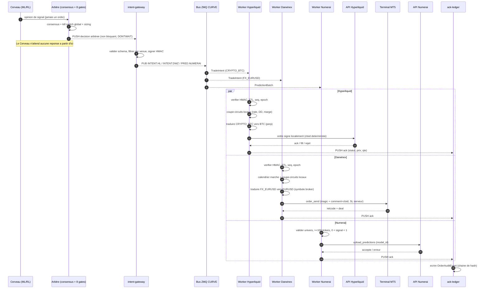
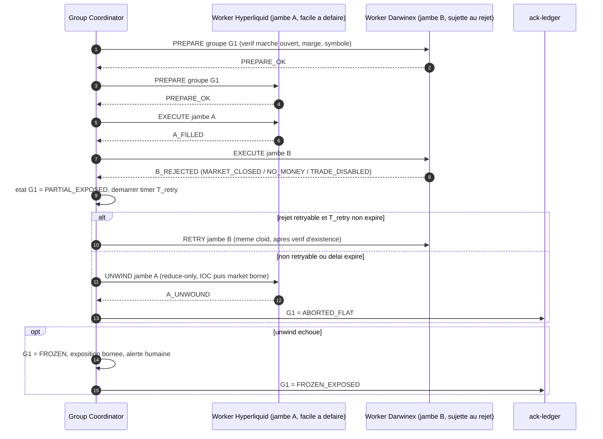

# Architecture Hub-and-Spoke : Cerveau Alpha vers 6 plateformes de capital externe, en 3 pôles

Statut : le **contrat** (`contracts/platform_signal.py`), le **transport signé** (`contracts/secure_signal_bus.py`) le **chiffrement du bus** (`contracts/curve_transport.py`, CURVE) et cinq workers (`workers/numerai`, `workers/hyperliquid`, `workers/bybit`, `workers/binance`, `workers/darwinex`, qui partagent le socle `workers/common`) sont implémentés et testés, mais **jamais exécutés contre les vraies plateformes**. Les 2 autres plateformes (Binance, Enzyme) ont leur nom réservé dans le contrat et **aucun worker**. Les faits sur les plateformes viennent de recherches web et sont marqués **[à vérifier]** quand les sources divergent ou manquent. Les éléments du repo cités existent réellement (chemins indiqués).

Périmètre : exactement 6 plateformes, celles du tableau ci-dessous.

| Pôle | Plateformes | Exécution | Worker |
|---|---|---|---|
| Crypto | `HYPERLIQUID`, `BINANCE`, `BYBIT`, `ENZYME` | temps réel | Hyperliquid, Bybit et Binance écrits (dry-run) ; Enzyme non écrit |
| Actions | `NUMERAI_SIGNALS` | batch quotidien | écrit (dry-run) |
| Forex / CFD | `DARWINEX_ZERO` | pont MT5 (Windows) | écrit (dry-run) |

---

## 0. Trois corrections de prémisses avant de construire

Le brief pose "zéro capital propre, zéro frais, zéro fuite d'IP". Les trois contraintes ne tiennent pas telles quelles. Mieux vaut le savoir avant de dessiner.

### 0.1 "Zéro capital, zéro frais" : tenable pour une seule plateforme sur six

| Plateforme | Coût réel d'entrée | Source |
|---|---|---|
| Numerai Signals | 0. Le staking de NMR est optionnel. Sans stake, tu reçois une performance mais, par inférence de la doc, pas de gain : le gain passe par le stake, donc par du capital **[inférence]**. | [docs.numer.ai](https://docs.numer.ai/numerai-signals/submissions) |
| Hyperliquid Vault | 100 USDC de dépôt minimum + 100 USDC de frais de création (doc courante ; une page "legacy" cite 10 000 USDC) + le leader garde au moins 5 % du vault en permanence. Nom et description du vault sont définitifs. **[confirmer le montant dans l'app]** | [HL docs](https://hyperliquid.gitbook.io/hyperliquid-docs/hypercore/vaults/for-vault-leaders), [Hummingbot](https://hummingbot.org/blog/funding-rate-arbitrage-and-creating-vaults-on-hyperliquid/) |
| Darwinex Zero | Abonnement mensuel payant. Pas de "challenge fee" au sens prop-firm, mais ce n'est pas gratuit. Prix divergents selon les sources (95 EUR d'inscription + 38 EUR/mois cité à l'époque du lancement) **[à vérifier sur darwinex.com]**. Le leader touche 15 % du profit sur capital alloué. | [Darwinex blog](https://blog.darwinex.com/darwinex-zero-new-subscription-service-what-is-it-and-how-it-works), [MQL5](https://www.mql5.com/en/blogs/post/773634) |
| Binance (lead trading) | Copy trading spot : portefeuille de lead entre 500 et 250 000 USDT (annonce de 2024) donc **capital propre requis** ; partage de profit de 10 % au lancement du spot. Critères actuels d'éligibilité pour le futures et disponibilité régionale **non trouvés** **[à vérifier]**. | [The Block](https://www.theblock.co/news/markets/2024-04-23-binance-spot-copy-trading-290345), [Binance dev docs](https://developers.binance.com/docs/copy_trading/future-copy-trading/Get-Futures-Lead-Trader-Status) |
| Bybit (master trader) | Critères officiels actuels **introuvables**. Une revue de 2024 décrit des niveaux (Cadet à Gold) avec des minimums d'actifs, de profits des followers sur 7 jours et de drawdown ; partage de profit de 10 à 15 %. **[à vérifier sur la page de candidature]** | [Coin Bureau (mars 2024)](https://coinbureau.com/review/bybit-copy-trading-review), [Bybit V5](https://bybit-exchange.github.io/docs/v5/copytrade) |
| Enzyme (vault EVM) | Création d'un vault via l'app (Ethereum ou Polygon). Aucun frais de création trouvé ; le coût documenté est le **gas** (créer et reconfigurer). Une modification des réglages d'un vault ne s'applique qu'après **7 jours**. Capital propre : non requis par la doc consultée, mais des déposants sont nécessaires pour avoir des fonds à gérer. | [Enzyme FAQ](https://docs.enzyme.finance/what-is-enzyme/faq), [reconfigurer un vault](https://docs.enzyme.finance/getting-started/customise-your-settings/reconfigure-your-vault) |

Conséquence : un budget minimal incompressible existe : environ 200 USDC pour Hyperliquid, l'abonnement Darwinex Zero, du gas pour Enzyme, et du capital propre pour Binance (et probablement Bybit). Seul Numerai est à coût nul pour entrer. Le plan ci-dessous le suppose.

### 0.2 "Zéro fuite d'IP" : vrai pour le code et les poids, faux pour l'alpha observable

Ce que l'architecture protège réellement : code, poids du modèle, features, hyperparamètres (aucun ne quitte le serveur du Cerveau).

Ce qu'elle ne peut pas protéger : le **flux d'ordres lui-même**. Un vault Hyperliquid est public et on-chain : positions, fills et timing sont lisibles par tous, copiables, et permettent de reconstruire une partie de la logique. Darwinex voit tous les trades. Numerai reçoit tes prédictions par construction. Mitigations en §5.4, sans promettre l'impossible.

### 0.3 Le moteur n'a pas encore de track record

Ces plateformes évaluent la performance réelle. Le dernier run 24 h en shadow (2026-09-23) s'est conclu NO-GO : 6 618 signaux de consensus, 0 fill, système resté en PANIC 98 % du temps après une coupure de flux, et le run n'a donc rien mesuré de la stratégie. Avant tout branchement externe, il faut une période de paper trading continue qui produit des fills mesurables (réarmement automatique du kill switch après reprise du flux, voir §6.6).

### 0.4 Le délai "1 à 3 mois" n'est confirmé par aucune source

La stratégie suppose un financement en 1 à 3 mois. Les sources trouvées ne le garantissent pour aucune plateforme : Darwinex Zero impose un entraînement de **90 jours maximum** avant que le DARWIN existe (le financement vient après)  ; pour Binance, Bybit et Enzyme, aucun délai n'a été trouvé. Prendre ce chiffre comme un objectif, pas comme un fait.

---

## 1. Architecture globale

### 1.1 Principe

Le Cerveau ne connaît aucune plateforme. Il publie une **intention** (jamais un ordre venue-spécifique) vers un `intent-gateway`, qui la valide, la filtre par venue, la signe, la diffuse. Chaque worker est un process isolé, sans route réseau vers le Cerveau.

```
                       [ HÔTE SÉCURISÉ LOCAL ]
 ┌──────────────────────────────────────────────────────────────────┐
 │ net_brain (Docker internal:true, AUCUN egress internet)          │
 │   brain  ──(ZMQ PUSH, non bloquant, HWM+drop)──►  intent-gateway│
 │   (modèles, poids, features)                                     │
 └───────────────────────────────────────────────┬──────────────────┘
                                                 │ (le gateway est sur 2 réseaux)
 ┌───────────────────────────────────────────────▼──────────────────┐
 │ net_bus (internal:true) : ZMQ PUB/XPUB + CURVE                   │
 └───┬──────────────────────────┬───────────────────────┬───────────┘
     │ pôle CRYPTO (temps réel) │ pôle ACTIONS (batch)  │ pôle FOREX (pont MT5)    
 ┌───▼──────────────────────┐ ┌─▼────────────────┐ ┌────▼─────────────────────┐
 │ w-hyper  w-binance       │ │ w-numerai        │ │ w-darwin                 │
 │ w-bybit  w-enzyme        │ │ egress: numer.ai │ │ HÔTE WINDOWS (terminal   │
 │ (enzyme : on-chain)      │ │                  │ │ MT5 requis)              │
 │ egress : sa plateforme   │ │                  │ │ egress : son courtier    │
 └───┬──────────────────────┘ └─┬────────────────┘ └────┬─────────────────────┘
     │ PUSH acks                │ PUSH acks             │ PUSH acks
     └──────────────────────────┴──────────┬────────────┘
                                     ┌─────▼──────┐
                                     │ ack-ledger │  (écrit dans l'audit ledger existant)
                                     └────────────┘   Le Cerveau ne lit PAS les acks en ligne.
```

**État réel du bus** : l'implémentation actuelle utilise **un seul topic** (`EXECUTION.SIGNAL`) ; chaque worker filtre sur `signal.targets(venue)` (`open_envelope`). Conséquence : tous les workers *reçoivent* tous les signaux. Des topics par plateforme, au niveau du gateway, restent à faire pour qu'un worker compromis ne voie que son propre flux (§5.2).

### 1.2 Règles de topologie

1. **Cerveau sans egress.** Réseau Docker `internal: true`. Les données de marché arrivent par un conteneur `market-data` séparé qui, lui, a un egress.
2. **Sens unique.** Brain → gateway par PUSH/PULL. Les acks vont à `ack-ledger`, pas au Cerveau. Une plateforme compromise ne peut ni interroger ni atteindre le Cerveau.
3. **Jamais bloquant.** Envoi ZMQ avec `DONTWAIT` et HWM borné. Si le bus est saturé, les intentions sont **abandonnées** (le TTL les aurait périmées de toute façon), jamais mises en file illimitée. Le Cerveau n'attend aucune réponse.
4. **Chiffrement + authentification du bus : ZMQ CURVE (implémenté, `contracts/curve_transport.py`).** Le pont est le serveur : clé secrète + liste blanche des clés publiques des workers (vérifiée par un gestionnaire ZAP). Chaque worker épingle la clé publique du serveur, donc un faux publisher ne peut pas se faire passer pour le vrai. Un client hors liste blanche, ou sans CURVE, ne reçoit rien : aucun repli en clair. Un serveur sans liste blanche est refusé (chiffré mais ouvert : la clé publique du serveur n'est pas secrète). Voir §1.5. *Les topics par plateforme, pour qu'un worker compromis ne voie que son flux, restent à faire (§5.2).*
5. **Egress en liste blanche par worker** (règles de pare-feu par conteneur) : `w-hyper` uniquement vers les domaines Hyperliquid, `w-numerai` uniquement vers numer.ai, etc.
6. **Worker Darwinex hors Docker Linux** : le package `MetaTrader5` est Windows-only et pilote un terminal MT5 en cours d'exécution. Il tourne en service Windows (ou VM Windows dédiée) et se connecte au bus en CURVE sur l'adresse du gateway.
7. **Aucune bibliothèque partagée avec le Cerveau.** Les workers importent uniquement un paquet `contracts` minimal (schémas Pydantic), jamais `core.quant_math` ni rien d'autre. Le repo a déjà un dossier `contracts/` ; il devient la frontière d'IP.

### 1.3 Réutilisation du repo

| Besoin | Existant à réutiliser |
|---|---|
| Bus pub/sub | `core/zmq_bus.py`, `core/zmq_broker.py` (le bus des workers, lui, est `contracts/secure_signal_bus.py` + `curve_transport.py`) |
| Schémas stricts | `core/schemas.py` : `extra="forbid"`, `frozen=True` (même discipline pour les nouveaux) |
| Kill switch global signé | `core/security.py` (HMAC + epoch anti-rejeu) |
| Coupe-circuits | `core/circuit_breaker.py` |
| Abstraction courtier | `src/execution/broker_gateway.py` : `BaseBroker`, `IBKRBrokerAdapter`, `CcxtBrokerAdapter` |
| Idempotence / audit | `src/execution/audit_ledger.py` (`OrderAuditEvent`, chaîne de hash) |
| Arbitrage multi-gates | `src/agents/execution/agent.py` (consensus, 8 gates) : reste **en amont** du gateway |
| Coffre de secrets | `src/execution/security_vault.py` |

Point de design important : le `TradingSignal` actuel (`-1/0/1` + `confidence`, jamais un ordre, consommé par `ExecutionAgent`) reste tel quel. Le nouveau flux part **après** l'arbitrage consensus et le kill switch global : les workers ne voient jamais une opinion brute de modèle, seulement une décision déjà arbitrée.

### 1.4 Le pont Cerveau -> workers (`src/bridge/`)

*Implémenté et testé : `src/bridge/platform_bridge.py`, lancé par `scripts/run_platform_bridge.py`. Jamais exécuté avec le vrai moteur en marche : voir les limites.*

**Format réel de la sortie du moteur** (lu dans le code, pas supposé) :

| Étape | Objet | Contenu |
|---|---|---|
| Opinion de chaque agent | `core.schemas.TradingSignal` sur le topic `TRADING_SIGNALS` | `timestamp`, `agent_id` (`supervisor-agent` = XGBoost, `rl-signal-agent` = PPO), `instrument` (`BTC/USDT`...), `signal` ∈ {-1, 0, 1}, `confidence` ∈ [0, 1] |
| Arbitrage | `ExecutionAgent` : consensus des deux agents, puis 8 portes | sorties : événement d'audit `GATE8_SEALED` (`ORDER_AUDIT_EVENTS`) et état des positions |
| État tenu par l'`ExecutionAgent` (Redis) | `NOTHIERLY_ACTIVE_POSITIONS` : liste JSON des positions non `FLAT` | `instrument`, `status` (`LONG`/`SHORT`), `entry_price`, `current_price`, `units`, `pnl`, `opened_at` |
| | `NOTHIERLY_EQUITY_CURVE` : liste Redis, la plus récente en tête | `{"timestamp", "balance"}` |
| | `heartbeat:execution-agent` : clé à durée de vie courte | présence = moteur vivant |

**Ce que le pont fait.** Il ne lit pas les opinions brutes et ne refait aucun arbitrage : il lit l'état arbitré ci-dessus, toutes les 2 s, et publie un `PlatformSignal` par instrument suivi.

- Position `LONG`/`SHORT` -> direction ; aucune position -> `FLAT`.
- Taille : `|unités| x prix / equity du moteur`, en %. C'est le dimensionnement du moteur (risque, plafonds) réutilisé tel quel ; plafonné par `--max-position-pct` (20 % par défaut). Chaque worker applique ensuite ce % à **sa** equity.
- `confidence_score` **n'est pas transmis** (interdit par le contrat pour toute plateforme crypto).
- **Taille quantifiée** (`--size-bucket-pct`, 2,5 par défaut ; `0` publie la taille exacte et exige `--allow-exact-size`). Le moteur dimensionne en risque fixe x multiplicateur de confiance (x0,7 à x1,5, `size_multiplier_from_confidence`) : sur une plateforme publique, la taille exacte laisserait lire la conviction que `confidence_score` interdit de transmettre. Le pont arrondit donc au palier le plus proche (`Decimal`, moitié vers le haut), au minimum un palier (un `LONG`/`SHORT` de taille 0 est invalide), plafonné à `--max-position-pct`, avec une hystérésis de 0,75 palier pour ne pas basculer à chaque cycle sur une frontière. **Limites :** la grille réduit la résolution, elle ne l'efface pas (un saut de palier reste un indice ; l'effacer demanderait une taille fixe, donc plus de dimensionnement par conviction) ; une position plus petite qu'un demi-palier est publiée à un palier (exposition externe surestimée). Aujourd'hui le modèle de méta-étiquetage n'est pas entraîné (multiplicateur x1,0) : la fuite est latente, pas active.
- **Durée minimale de maintien** (`--min-hold-s`, 60 s par défaut, 0 = aucune). Constat sur le vrai moteur (2026-10-13, MOCK_MODE) : des positions de 6 s à une minute, donc des allers-retours que chaque worker paierait deux fois en frais et glissement. Le pont ne publie la **fermeture ou l'inversion** d'une position qu'une fois celle-ci publiée depuis `min_hold_s` ; entre-temps il republie la cible qu'il tient, et si le moteur rouvre dans le même sens le worker ne voit jamais de `FLAT`. Ouvertures, changements de taille de même sens, kill switch et moteur silencieux ne sont **jamais** retardés. **Prix assumé** : pendant le délai, l'exposition externe reste ouverte alors que le moteur est déjà sorti (au pire `min_hold_s` de risque non voulu, y compris si le marché tourne contre la position) ; le délai se compte depuis la première publication par le processus du pont, donc un redémarrage tient une position déjà ouverte `min_hold_s` de plus. N'agit pas sur ce qui précède le pont : le moteur continue à ouvrir et fermer vite, seul ce qui sort vers les plateformes est lissé.
- Republication seulement si la cible change (direction, ou 0,25 point de plus ou de moins) ou toutes les 10 s : un worker lancé en retard se cale, et republier un état identique est sans effet (exposition cible).
- Un état plutôt qu'un flux d'événements : une fermeture simulée en MOCK/SHADOW ne publie pas toujours `TRADE_EXECUTED`, un événement de sortie manqué laisserait une position externe ouverte.

**Repli (toujours dans le sens qui réduit l'exposition).** Kill switch global actif (`PANIC`, `LATCHED_DATA`, Redis injoignable, signature invalide) : `FLAT` immédiat. Moteur silencieux (heartbeat absent) ou état illisible plus de 30 s : `FLAT`. Dans le délai de grâce : on ne publie rien.

**Heartbeat du moteur et démarrage à froid.** Le heartbeat (`core/heartbeat.py`) est écrit par un thread dédié avec son propre client Redis (délais bornés à 2 s), pas par une tâche de la boucle asyncio partagée : un calcul bloquant (inférence, Lyapunov, Kelly) ne le retarde plus. Intervalle 3 s, TTL 10 s (ratio ≥ 3, refusé à la construction sinon). `run_backend.py` l'arme (`engine:state = STARTING`) avant le chargement des modèles `.json`/`.pt` ; `ExecutionAgent.run()` passe à `ACTIVE` quand l'agent peut décider. Le pont ne publie rien et n'alerte pas tant que le moteur est `STARTING` ou n'a jamais été vu, dans la limite de `--engine-startup-grace-s` (180 s) ; passé cette borne, le silence redevient une panne (FLAT après 30 s). Kill switch prioritaire dans tous les cas. Côté workers : aucun accès à Redis (frontière AST). Le déclenchement de l'homme mort suspendu par `dead_man_startup_grace_s` est journalisé une fois (WARNING), et `--dead-man-timeout` < 30 s est refusé par la CLI (3 republications du pont de 10 s), 30–60 s avertit. Equity inconnue avec une position ouverte : rien n'est publié pour elle (on ne devine pas une taille).

**Réconciliation d'état au redémarrage : adopter, puis réévaluer** (`src/agents/execution/reconciliation.py`). `ExecutionAgent._positions` est en mémoire : sans réconciliation, un redémarrage repart « à plat » et le pont ferme au marché la position réelle (spread et frais taker pour une opération de maintenance). Avec `NOTHIERLY_RECONCILE_VENUES=HYPERLIQUID,BYBIT` (ordre = priorité), le moteur passe par `RECONCILING` : il lit `exchange:positions:<PLATEFORME>`, publié toutes les 30 s par `nothierly-position-reporter` (service à part, clés en LECTURE SEULE : `reporter.env.example` ; Hyperliquid n'exige aucune clé), convertit l'exposition du compte réel en unités du moteur, l'inscrit dans `_positions`, puis seulement passe `ACTIVE`. Le pont ne publie RIEN pendant `STARTING`/`RECONCILING` (jamais de `FLAT` sur un état non vérifié) et reprend avec la position adoptée, d'où l'absence d'ordre. Sans rapport frais, le moteur ne passe pas `ACTIVE` et réessaie ; au bout de `--engine-startup-grace-s` (300 s) le pont traite ce silence comme une panne et ferme (repli prudent connu). Limites : le prix d'entrée, l'ancre du stop suiveur et la date d'ouverture réels ne sont pas rapportés (ils repartent du prix de marché au moment de l'adoption) ; le moteur ne sait qu'ouvrir ou fermer, donc une taille au-dessus du plafond du pont (20 %) est ramenée au plafond par le pont, pas par le moteur ; sans `NOTHIERLY_RECONCILE_VENUES` le comportement historique (départ à plat) est inchangé.

**Limites de débit REST (HTTP 429/418).** `workers/common/ratelimit.py` : le `Retry-After` est conservé par le transport, une porte partagée par client refuse localement toute requête pendant la pause, et l'exécuteur du worker dort la durée exacte (`asyncio`, interruptible) avant de réessayer le signal le plus récent ; un refus 429 n'a pas traité l'ordre, donc le renvoi ne peut pas le doubler. 418 (IP bannie, Binance) alerte immédiatement. Non couverts : les autres signaux de limite de Bybit (code `retCode`, HTTP 403).

**Flux WebSocket muet.** Une connexion semi-ouverte ne lève aucune erreur : sans garde, le VPIN gelé était ré-écrit comme frais. `--stale-after-s` (60 s) supprime la clé Redis, alerte et reconnecte ; le keepalive TCP (30 s + 3 x 10 s) couvre les flux où le client n'envoie rien.

**Maintenance.** `scripts/maintenance_cron.py` (service `nothierly-maintenance`, `docker-compose.shadow.yml`) : purge par lots des SQLite (VPIN 180 j, intentions 7 j, signaux vus 7 j ; les fills sont gardés), `VACUUM` conditionnel, compression (7 j) et rétention (120 j) de `bus_messages`. Exporter avant de raccourcir une rétention.

**Ce que le pont ne peut pas faire, honnêtement :**

- **Pas d'actions.** Le moteur n'a aucun modèle d'actions : ses instruments sont `BTC/USDT`, `ETH/USDT`, `EUR_USD`, `XAU_USD`. Rien ne peut alimenter `NUMERAI_SIGNALS`, qui exige 100 scores d'actions par jour minimum. Il faudrait un modèle de classement de l'univers d'actions, ce qui est un projet à part.
- **Pas de forex dans le pont.** Le moteur ne fournit pas de `stop_loss_price` ; le worker Darwinex saurait en poser un par défaut, mais le pont ne traduit pour l'instant que les paires crypto : `EUR_USD` et `XAU_USD` sont ignorés (avec un avertissement).
- **Décisions simulées.** En `MOCK_MODE`/`SHADOW`, les positions du moteur sont simulées. Un worker en mode live tradera de l'argent réel d'après elles : garder les workers en dry-run, testnet ou démo. Le pont l'affiche au démarrage.
- **Comptes dédiés.** Un worker ramène le compte à la cible de chaque symbole suivi, y compris `FLAT` : une position ouverte à la main sur ce symbole serait fermée.
- **Si le pont ou le moteur meurt**, ce sont les workers qui protègent : leur homme mort ferme toutes leurs positions après N secondes sans signal valide, puis les verrouille (voir §6.7).

### 1.5 Chiffrement du bus (CURVE)

*Implémenté et testé sur de vrais sockets TCP, y compris sous Windows. Jamais éprouvé sur un réseau réel entre deux machines.*

**Ce que CURVE ajoute au HMAC.** Le HMAC prouve qu'un message vient du moteur ; il ne le cache pas. Sur internet ou entre VPS, un observateur lirait le payload, donc l'alpha. CURVE (Curve25519) chiffre et authentifie le canal lui-même. Le HMAC reste : il protège aussi contre un message rejoué ou fabriqué par un pair déjà autorisé.

| Propriété | Preuve dans les tests |
|---|---|
| Opacité sur le fil | Un relais TCP enregistre tous les octets : sans CURVE (témoin) il lit la paire `CRYPTO_BTC_USD`, `position_size_pct`, la signature ; avec CURVE, aucun de ces fragments n'apparaît. |
| Authentification des clients | Une clé publique hors liste blanche ne reçoit rien, et le refus est journalisé (préfixe de clé seulement). |
| Pas de repli en clair | Un client sans CURVE ne peut pas lire un serveur CURVE ; un client CURVE ne se rabat pas sur un publisher en clair. |
| Pas d'usurpation du publisher | Un faux publisher chiffré (autre clé serveur) n'est pas écouté par un worker qui épingle la vraie clé publique. |

**Déploiement.** `python scripts/generate_curve_keys.py --clients hyperliquid bybit numerai darwinex --out-dir secrets/curve` écrit `curve_server.env` (clé secrète du serveur + clés publiques des workers) et un `curve_<worker>.env` par worker (sa paire + la clé publique du serveur). Chaque fichier va sur **sa** machine uniquement ; le script n'affiche jamais une clé secrète, refuse d'écraser un fichier (régénérer invalide les clés déployées) et signale un dossier non ignoré par git. Les variables : `NOTHIERLY_CURVE_SERVER_SECRET`, `NOTHIERLY_CURVE_CLIENT_KEYS` (serveur) ; `NOTHIERLY_CURVE_SERVER_PUBLIC`, `NOTHIERLY_CURVE_CLIENT_PUBLIC`, `NOTHIERLY_CURVE_CLIENT_SECRET` (worker).

**Garde-fous de ligne de commande.** Un endpoint non local sans CURVE est **refusé** par le pont, l'injecteur et les quatre workers, sauf `--allow-plaintext-remote` (choix explicite, à vos risques). Une configuration CURVE partielle est une erreur, jamais un repli en clair.

**Interrupteur `NOTHIERLY_ZMQ_ENCRYPTION`.** Absent ou `auto` : CURVE si les clés sont dans l'environnement (comportement historique). `true` : CURVE **obligatoire**, des clés manquantes sont une erreur de démarrage (c'est la valeur posée dans `docker-compose.platform.yml`, pour qu'un fichier `.env` oublié ne démarre pas un bus en clair). `false` : les clés sont ignorées, canal en clair, pour les tests locaux ; cela ne contourne pas la règle ci-dessus : un endpoint non local reste refusé sans `--allow-plaintext-remote`. Une valeur inconnue est une erreur (une faute de frappe ne coupe pas le chiffrement). Préfixe `NOTHIERLY_` et non `ZMQ_`, qui est celui de `core.config.ZmqSettings`.

**Conteneurs (`Dockerfile.platform`, `docker-compose.platform.yml`).** Image séparée de celle du moteur (pas de torch ni de données de recherche à côté de clés d'exchange), une seule image pour le pont et les workers Hyperliquid et Bybit, choisis par la commande. Le compose est une **superposition** à `docker-compose.yml` : le pont doit lire le Redis du moteur (`redis-broker`), pas un Redis vide. Aucun port publié ; workers en dry-run sur testnet, le passage en réel est une modification relue de leur `command`. **Jamais construit ni lancé** : Docker n'est pas installé sur la machine de développement. Ce qui a été vérifié : le YAML se charge et les références de services existent ; le pont et les workers démarrent depuis un virtualenv vierge ne contenant que `requirements-platform.txt`, dans l'arborescence exacte que copie le Dockerfile. **Limite connue** : le pont charge toute la configuration du moteur (`core.config`) pour vérifier la signature du kill switch avec la clé du coffre, donc son conteneur reçoit le `.env` du moteur, identifiants de broker compris. À découpler (lecture du seul `VaultSettings`) avant un déploiement où le pont est moins protégé que le moteur. Procédure de validation locale : `docs/DRY_RUN_PROTOCOL.md`.

**Limites.**

- CURVE ne cache pas la taille ni le rythme des messages, et ne protège pas contre un hôte compromis (les clés sont en mémoire sur chaque machine).
- Les clés sont des chaînes Z85 sans somme de contrôle : seuls la longueur et l'alphabet se vérifient. Une faute de frappe dans la clé publique d'un serveur épinglé empêche simplement le canal de s'établir.
- **Défaut trouvé en route** : le `ThreadAuthenticator` de pyzmq lance une boucle `asyncio` dans son thread ; sous Windows (boucle Proactor par défaut) ce thread meurt, plus aucun client n'est jamais autorisé et `stop()` bloque à jamais. Il est remplacé par un gestionnaire ZAP minimal, synchrone et sans asyncio (`ClientAuthenticator`).
- Un serveur CURVE exige son propre contexte ZeroMQ (le gestionnaire ZAP y est lié).

---

## 2. Contrats de messages

> **Le contrat réellement implémenté est `contracts/platform_signal.py` (`PlatformSignal`)**, avec le transport signé de `contracts/secure_signal_bus.py`. Les schémas `TradeIntent` et `PredictionBatch` ci-dessous sont la conception initiale, gardés pour référence ; en cas de différence, le code fait foi. Différences notables : `confidence_score` n'est transmis qu'à `NUMERAI_SIGNALS` (interdit partout ailleurs), `position_size_pct` est une exposition **cible**, et `target_venue=ALL` couvre toutes les plateformes de la classe d'actif du signal.

### 2.1 `TradeIntent` v1 (Hyperliquid, Darwinex Zero)

```json
{
  "schema": "trade_intent",
  "schema_version": 1,
  "msg_id": "0192f3c8-7a52-7c1e-9b0a-3f6d1c2e8a41",
  "stream_seq": 48213,
  "emitted_at_ns": 1760371200123456789,
  "ttl_ms": 1500,
  "kill_epoch": 159,
  "brain_ref": "b-01",
  "group_id": null,
  "instrument": "CRYPTO_BTC",
  "intent": "TARGET_EXPOSURE",
  "side": "LONG",
  "target_exposure_frac": 0.12,
  "order_style": "LIMIT_IOC",
  "limit_px_bps_from_ref": 4,
  "ref_px": 86512.5,
  "reduce_only": false,
  "urgency": "NORMAL",
  "sig": "base64(hmac_sha256(canonical_json_without_sig))"
}
```

Choix de conception :

- **`target_exposure_frac`** (fraction du capital du compte), jamais un montant absolu. Chaque worker le convertit avec **sa propre** equity lue sur la venue. Évite de fuiter la taille réelle du Cerveau et rend chaque compte autonome.
- **`intent`** ∈ `TARGET_EXPOSURE | FLATTEN | REDUCE | HALT`. Un état cible est idempotent par nature : rejouer le même message ne double pas la position (contrairement à "acheter 1 BTC").
- **`ttl_ms` + `emitted_at_ns`** : le worker rejette tout message périmé (latence, file, reconnexion). Contrôle d'horloge : dérive NTP surveillée, rejet si skew > seuil.
- **`stream_seq`** monotone par topic : un trou révèle un message perdu ; le worker se resynchronise sur l'état cible courant (pas de rattrapage des intentions manquées).
- **`kill_epoch`** : l'epoch du kill switch global signé. Le worker refuse un message dont l'epoch est inférieur à son plus haut epoch vu (même logique anti-rejeu que `core/security.py`).
- **`sig`** : HMAC (clé distincte par worker, rotation planifiée). CURVE authentifie le canal, le HMAC authentifie le message.
- **Pas de `confidence`, pas de features, pas de nom d'agent.** Seule une décision arbitrée sort. `brain_ref` est opaque.
- **`group_id`** : renseigné seulement pour les jambes d'un groupe couvert (voir §6.3), `null` par défaut.

L'identifiant d'ordre côté venue est dérivé de façon déterministe : `client_order_id = H(msg_id || venue || leg)`. Hyperliquid accepte un `cloid` de 128 bits hex ; pour MT5 on le met dans `comment` et on encode un `magic` par stratégie.

### 2.2 `PredictionBatch` v1 (Numerai Signals)

```json
{
  "schema": "prediction_batch",
  "schema_version": 1,
  "msg_id": "…",
  "as_of_date": "2026-10-13",
  "universe_ver": "numerai-signals-2026-10-13",
  "rows": [
    {"instrument": "EQUITY_US_AAPL", "score": 0.7312},
    {"instrument": "EQUITY_US_MSFT", "score": 0.4127}
  ],
  "sig": "…"
}
```

Contraintes Numerai (doc officielle) : colonne ticker valide (sedol, bloomberg_ticker, composite_figi ou numerai_ticker) + colonne `signal` strictement entre 0 et 1, **au moins 100 tickers valides** de l'univers du jour, pas de doublon. Le worker revalide avec `ticker_universe()` avant l'upload. Le Cerveau envoie des **scores**, jamais des probabilités brutes de modèle : un classement rang-normalisé suffit et fuite moins.

---

## 3. Diagrammes de séquence (Mermaid)

### 3.1 Flux nominal



### 3.2 Échec asymétrique d'un groupe couvert



---

## 4. Spécifications par worker

### 4.1 Langage : Python partout

Rust ou C++ n'apportent rien ici. La latence est dominée par l'API de la venue (centaines de ms pour Hyperliquid, IPC vers le terminal pour MT5, job quotidien pour Numerai), pas par le code du worker. Les SDK officiels sont en Python, et la fiabilité (reconnexion, idempotence, réconciliation) compte plus que la vitesse. Seule exception défendable : un EA MQL5 côté Darwinex si le package Python s'avère instable (§4.3).

### 4.2 Worker Hyperliquid

*Implémenté : `workers/hyperliquid/` (dry-run testnet par défaut, jamais exécuté contre le service).*

- **SDK** : `hyperliquid-python-sdk` (officiel). REST pour les ordres, WebSocket pour `userEvents`, `orderUpdates`, `l2Book`.
- **Auth** : ne jamais mettre la clé du wallet maître dans le worker. Créer une **API wallet** (agent) approuvée par le maître : elle peut trader mais **ne peut pas retirer**. Pour un vault, l'ordre est passé avec `vaultAddress` ; vérifier dans la doc courante que l'agent du leader est autorisé pour le vault **[à vérifier avant le dev]**.
- **Nonces** : Hyperliquid impose des nonces par signataire. Un API wallet **distinct par process** évite les collisions si tu scales plus tard.
- **Clé** : jamais en clair dans l'image. Docker secret ou `security_vault.py`, chargée en mémoire au démarrage.
- **Dead-man switch** : armer périodiquement `scheduleCancel` (annulation automatique des ordres si le worker meurt) **[vérifier l'action dans la doc courante]**.
- **WebSocket** : ping applicatif régulier (la doc indique une fermeture sur inactivité d'environ 60 s **[à vérifier]**), reconnexion avec backoff exponentiel + jitter, puis **resynchronisation par REST** (`clearinghouseState`, `openOrders`) avant de reprendre. Jamais de reprise sur la seule foi du flux WS.
- **Table de symboles** : `CRYPTO_BTC` → `BTC` (perp), `CRYPTO_ETH` → `ETH`, avec précision de prix/taille propre à chaque marché lue depuis `meta`.

### 4.3 Worker Darwinex Zero

*Implémenté : `workers/darwinex/` (dry-run par défaut). **Jamais exécuté contre un vrai terminal MetaTrader 5** : le paquet `MetaTrader5` n'est pas installé ici et aucun compte n'a été utilisé. Testé avec un faux module, dont les constantes sont des nombres arbitraires pour vérifier qu'elles sont utilisées par leur nom.*

**Fait pour Windows.** Le paquet `MetaTrader5` n'existe que sous Windows et pilote un terminal MT5 installé et lancé : le worker tourne sur l'hôte Windows, reçoit ses signaux du bus (chiffré en CURVE) et agit comme pont local. Lancé ailleurs, il s'arrête proprement avec un message clair (code 2, pas de trace) : `UnsupportedPlatformError` hors Windows, `Mt5NotInstalledError` si le paquet manque. Le contrôle est dans le client et non à l'import : avec un module simulé il ne s'applique pas, ce qui laisse les tests tourner sur un pipeline CI Linux (non vérifié ici : seulement exécutés sous Windows).

**Ce que dit la doc officielle (MQL5), appliqué dans le code.**

- `order_send` : action `DEAL`, `type` BUY/SELL, `deviation` en points, `sl`, `magic`, `comment`, `type_filling`, `position` = ticket pour fermer. Codes de retour : 10009 fait, 10010 partiel, 10008 placé, 10012 délai et 10031 connexion (ambigus, jamais rejoués), 10018 marché fermé, 10019 pas assez de fonds, 10016 stops invalides, etc.
- Remplissage : IOC/FOK toujours permis en exécution Instant/Request ; selon les drapeaux du symbole en exécution Market ; `RETURN` interdit en exécution Market. Si aucune politique ne convient, l'ordre est refusé (`no_valid_filling`).
- En exécution Market le prix n'est pas utilisé : la déviation ne plafonne alors pas le glissement, l'ordre est un ordre au marché.
- `initialize()` sans identifiants reprend « le dernier compte » du terminal.

**Garde-fous de compte, parce que le terminal trade le compte sur lequel il est connecté, quel qu'il soit.** Le numéro de compte doit être exactement `--account-login` (obligatoire), vérifié à chaque lecture **et** juste avant chaque ordre : un compte ouvert à la main dans le même terminal n'est jamais piloté. Un compte de type réel est refusé sans `--allow-real-account`, et `--live` sur un compte réel exige l'homme mort.

**Sizing.** Un lot Forex n'a pas la valeur « prix × quantité ». Le client mesure la valeur d'un lot en devise du compte avec `order_calc_profit` (gain d'un lot pour un petit mouvement de prix, ramené au prix) : cela gère les paires non cotées en USD et l'or. Les lots sont arrondis vers zéro au pas de volume ; un compte trop petit pour un lot minimal à ce pourcentage répond `below_min_volume` (et non un trompeur `on_target`).

**Ordres.**

- **Stop-loss serveur** sur toute ouverture (le score de risque Darwinex l'impose). Le `stop_loss_price` du signal est utilisé s'il existe ; refusé s'il est du mauvais côté ou plus près que `trade_stops_level`, **jamais remplacé en silence**. S'il manque, le worker pose un stop par défaut à `--default-stop-loss-bps` du prix de l'ordre (100 = 1 % par défaut ; le prix limite pour un `LIMIT`), reculé au besoin à la distance minimale du courtier, et le journal le note. `--default-stop-loss-bps 0` le désactive : un signal sans stop est alors refusé (`missing_stop_loss`). Le contrat n'exige donc plus le stop (il le valide s'il est présent). Un stop n'est posé qu'à l'ouverture.
- **Une inversion se fait en deux temps** : sur un compte hedging, un ordre opposé plus gros ouvre une position inverse sans fermer la première. Le worker ferme d'abord (avec le ticket), le signal suivant ouvre le reste.
- Une seule position nette par symbole : plusieurs positions (hedging) arrêtent l'ordre (`hedge_positions_unsupported`).
- Les modes `CLOSEONLY`, `LONGONLY`, `SHORTONLY`, `DISABLED` bloquent les ouvertures mais jamais une fermeture ; un spread trop large (`--max-spread-bps`) bloque une ouverture, jamais une fermeture.
- Idempotence : `magic` (identifiant de stratégie) et commentaire déterministe par signal ; aucun nouvel essai après une réponse ambiguë, la position est relue au signal suivant.
- Tous les appels MT5 passent par un verrou unique (l'API n'est pas documentée comme réentrante).

**Limites à connaître.**

- **Week-end** : marché fermé = ordre refusé (`MARKET_CLOSED`). L'homme mort réessaie à chaque intervalle, donc une position non fermable reste ouverte jusqu'à la réouverture : le risque de gap n'est pas couvert par ce worker, seul le stop serveur l'est.
- **Plateforme exacte du compte Darwinex Zero** (MT4/MT5, type de compte, symboles et suffixes) : **[à vérifier avant tout usage]**. Les trades alimentent l'indice DARWIN après un entraînement de 90 jours maximum, donc le worker ne doit jamais envoyer d'ordre de test.
- Les ordres `LIMIT` ne sont pas honorés comme tels en exécution Market.
- `order_calc_profit` est pris comme renvoyant des unités de la devise du compte (c'est ce que montre l'exemple de la doc) : si une valeur est indéterminable, rien n'est ordonné (`no_valuation`).

### 4.4 Worker Numerai Signals

*Implémenté : `workers/numerai/` (dry-run par défaut, jamais soumis).*

- **SDK** : `numerapi` (`SignalsAPI` : `upload_predictions`, `ticker_universe`). Clés `public_id` / `secret_key` à portée **limitée** (upload seulement).
- **Cadence** : une fois par période de soumission. Pas de temps réel, pas de risque d'exécution : le pire cas est un fichier invalide ou manqué.
- **Garde-fous** : ≥100 tickers de l'univers du jour, 0 < signal < 1, pas de doublon, dérive de distribution (corrélation avec la soumission précédente) pour détecter un modèle cassé avant l'envoi.
- **Sortie** : le seul worker dont la "fuite" (scores par ticker) est le produit lui-même.

### 4.5 Worker Binance (USDⓈ-M futures)

*Implémenté et testé : `workers/binance/` (`planner`, `client`, `worker`) et `ws_tracker.BinanceFillFeed`. Dry-run sur le réseau de test par défaut ; jamais exécuté contre Binance, aucune clé utilisée. Les tests portent sur des réponses simulées.*

**Ce que fait le worker.** Il hérite du socle commun (signature, file « dernier signal », drawdown, homme mort, alertes, suivi des fills) et traduit un `PlatformSignal` ciblant `BINANCE` (ou `ALL`) en ordre sur un perpétuel **USDT** (`BTCUSDT` ; les contrats USDC et à échéance sont ignorés). Précision par `exchangeInfo` : pas de quantité (`LOT_SIZE.stepSize`, arrondi vers zéro), pas de prix (`PRICE_FILTER.tickSize`), quantité et notionnel minimaux. Comme les autres workers, un signal `MARKET` part en **limite IOC** bornée par le glissement maximal (un vrai ordre `MARKET` n'a aucun plafond de prix). Client REST en stdlib, signé HMAC-SHA256 : pas de `binance-futures-connector`.

**Sécurités au démarrage** (la CLI s'arrête avec le code 2 et un message, sans trace) :

- **Droit de retrait** : lu sur `GET /sapi/v1/account/apiRestrictions` (hôte spot `api.binance.com`, champ `enableWithdrawals`). **Ce n'est pas `/fapi/v1/apiTradingStatus`**, qui ne renvoie que des indicateurs de règles quantitatives (verrous) et ne dit rien des permissions de la clé : la clé est refusée si le retrait est actif, et en **mainnet** aussi quand ses droits ne peuvent pas être lus (l'absence de retrait ne se prouve pas). Le réseau de test n'a pas cet endpoint : la vérification y est indisponible, journalisée, non bloquante.
- **Mode de position** : `GET /fapi/v1/positionSide/dual` ; hedge = arrêt. En marche, une position `LONG`/`SHORT` hedge arrête l'ordre (`hedge_mode_unsupported`).
- Mainnet live : `--live --network mainnet --i-understand-real-funds` et homme mort obligatoire, comme les autres.

**Réponse d'ordre et erreurs.** `newOrderRespType=RESULT` : statut final `filled`, `partial`, `unfilled` ou `rejected`. Un refus de Binance (code négatif, par exemple `-2019` marge insuffisante) est `rejected` ; une réponse illisible, un délai dépassé ou `-1007` (statut inconnu) lèvent : pas de nouvel essai à l'aveugle, le signal suivant relit la position. Une dérive d'horloge (`-1021`) resynchronise sur `/fapi/v1/time` et retente une fois.

**Flux de fills.** `POST /fapi/v1/listenKey` (clé prolongée toutes les 30 min, redemandée à chaque reconnexion), flux privé `wss://fstream.binance.com/private/ws?listenKey=<clé>&events=ORDER_TRADE_UPDATE` (le schéma `/public` `/market` `/private` remplace l'ancien `/ws/<clé>`, arrêté sur la production le 2026-04-23 selon la doc). **Chaque exécution (`x == "TRADE"`) est un fill**, partielle ou finale : ne retenir que `FILLED` perdrait les exécutions partielles. Rapprochement par `newClientOrderId` (champ `c`) puis `i`, avec l'intention enregistrée avant l'envoi.

**Ce qui n'est pas vérifié, à contrôler avant tout argent réel.**

- **Réseau de test** : la doc donne `demo-fapi.binance.com` (page générale) et, ailleurs, `testnet.binancefuture.com`, et aucune des deux pages consultées ne donne l'adresse WebSocket du test pour le nouveau schéma. L'adresse REST se surcharge (`--base-url`) et l'adresse WebSocket aussi (`--ws-base-url`) ; celle par défaut (`wss://demo-fstream.binance.com`) est la plus plausible, pas confirmée. Une source tierce dit que l'ancien chemin du test s'est arrêté le 2026-09-12.
- **Schéma de `ORDER_TRADE_UPDATE`, filtres `exchangeInfo` et `bookTicker`** : la page officielle consultée ne les détaillait pas ; le code suit la forme historique de l'API.
- `account` V3 : l'equity est `totalMarginBalance` (compte en marge mono-actif USDT) ; en mode multi-actifs ou portefeuille la lecture serait différente.
- **Lien avec le copy trading de Binance : toujours inconnu.** L'API documentée du statut de lead trader futures (`isLeadTrader`) et de la liste de symboles autorisés (`/sapi/v1/copyTrading/futures/leadSymbol`) est de lecture ; on n'a pas confirmé qu'un compte lead puisse passer des ordres par API pour son portefeuille de copy trading, ni les conditions d'éligibilité. Ce worker ordonne sur un compte futures ordinaire ; que ses ordres soient ceux copiés par des followers dépend de ce point.

### 4.6 Worker Bybit (master trader)

*Implémenté : `workers/bybit/` (dry-run testnet par défaut, jamais exécuté contre le service, aucune clé utilisée).*

Ce qui vient de la doc V5 officielle et est appliqué dans le code :

- **Ordre** : `POST /v5/order/create` (`category=linear`), quantité et prix en chaînes, `orderLinkId` unique de 36 caractères maximum, `reduceOnly`, `positionIdx`. **Perpétuels USDT uniquement** pour le copy trading ; le champ `copyTrading` d'`instruments-info` dit si un symbole est éligible (le worker refuse `none`).
- **Signature** : `HMAC_SHA256(secret, timestamp + clé API + recv_window + (query | corps JSON))`, en hexadécimal ; le corps est signé tel qu'envoyé. Testée contre la formule recalculée indépendamment.
- **Réponse asynchrone** : Bybit n'accuse que la réception (« please use the websocket to confirm the order status »). Le statut journalisé est `accepted`, jamais `filled` : le remplissage réel se lit dans la position au signal suivant, qui est la source de vérité de la logique d'exposition.
- **Garde-fou de clé** : `GET /v5/user/query-api` expose les permissions. La CLI **refuse toute clé avec `Wallet: Withdraw`** (même en dry-run), et en mode live toute clé en lecture seule ou sans « Contract - Orders & Positions ».
- Les ordres `MARKET` du signal sont envoyés en **limite IOC** bornée par `max_slippage_bps` autour du mid (le plafond de glissement est le nôtre) ; achat arrondi au tick supérieur, vente au tick inférieur.

**Inconnues non tranchées par la doc, traitées en échec sûr** (à vérifier sur testnet avec une vraie clé) :

- **Où sont les fonds d'un master trader ?** Seul `accountType=UNIFIED` est documenté pour `wallet-balance`. Une equity lue sur le mauvais compte fausserait la taille des ordres. Parade : `--max-equity-usd` plafonne l'equity utilisée pour dimensionner.
- **Mode de position.** Le worker ne gère que le mode one-way (`positionIdx` 0) ; une position hedge arrête l'ordre (`hedge_mode_unsupported`). L'exemple copy trading de la doc utilise `positionIdx: 1` : si les comptes de copy trading sont en hedge, le worker devra être étendu.
- **Dry-run avec clé.** Solde et positions sont des données privées : même le dry-run exige une clé API (en lecture seule de préférence).
- Critères pour devenir master : introuvables officiellement (voir §0.1) ; passer par la page de candidature de Bybit.

### 4.7 Worker Enzyme (vault EVM) : non écrit

- **Nature différente des autres** : transactions on-chain (gas, confirmation en blocs, slippage, exposition au MEV). Pas de temps réel type Hyperliquid. Le repo a déjà un relais protégé contre le MEV (commit `c0d6026`) à évaluer.
- **Intégrations** : le trading passe par des adaptateurs DeFi (Uniswap, Aave, Compound, GMX, Balancer, Curve...). Un manager peut restreindre les adaptateurs autorisés. La doc décrit aussi un mode de **trading délégué** (équivalent d'un wallet agent) **[à lire avant de concevoir l'authentification]**.
- **Vault spot** : un `SHORT` n'est pas exécutable sur du spot. Le worker devra traiter `SHORT` comme `FLAT` (ne pas shorter), sauf intégration de perpétuels (GMX) confirmée.
- **Réglages** : toute modification du vault est soumise à un délai de 7 jours, donc les paramètres de risque se fixent à la création, pas au fil de l'eau.

### 4.8 Gestion des secrets (commun)

1. Aucun secret dans l'image ni dans git (`real_keys.env` à la racine du repo est à sortir du dossier de travail et à auditer).
2. Docker secrets (fichiers montés en tmpfs) ou `security_vault.py`.
3. Clés à privilège minimal : API wallet sans retrait (HL), upload seul (Numerai), clé API sans droit de retrait (Binance, Bybit : ordres seulement), wallet délégué sans retrait (Enzyme).
4. Rotation planifiée des clés HMAC du bus et des clés CURVE.
5. Les logs des workers ne contiennent jamais de clé, de signature complète ni de champ du Cerveau.

---

## 5. Protection de l'IP

### 5.1 Ce qui sort, par plateforme

| Plateforme | Ce qui sort | Réversibilité |
|---|---|---|
| Numerai | scores par ticker | volontaire, c'est le produit |
| Hyperliquid | ordres + positions publiques on-chain | **élevée** : copiable, partiellement déductible |
| Darwinex Zero | trades du compte, copiés aux investisseurs | moyenne |
| Binance, Bybit | trades du compte lead, **visibles et copiés par les followers** | élevée : le copy trading est de la copie par construction |
| Enzyme | transactions et positions **publiques on-chain** | élevée |

### 5.2 Règles

1. Le gateway **filtre** : chaque topic ne contient que le strict nécessaire pour sa venue. *(À faire : aujourd'hui un seul topic, voir §1.1.)*
2. Tailles relatives (fractions), jamais d'absolu.
3. Pas de features ni de nom d'agent dans les messages ; `confidence_score` **uniquement** pour `NUMERAI_SIGNALS` (le contrat refuse tout signal qui l'envoie ailleurs).
4. Workers sans accès au Cerveau (réseaux séparés, sens unique).
5. Poids et code du modèle chiffrés au repos sur l'hôte du Cerveau, aucun volume partagé avec les workers.

### 5.3 Mitigations de l'alpha observable (Hyperliquid surtout)

Aucune ne rend la stratégie indéductible ; elles augmentent le coût de copie :
- Bruit de timing borné (jitter de quelques centaines de ms) et fractionnement des ordres.
- Prix limites légèrement variés.
- Éviter les signatures évidentes (même taille, même heure).
- Choisir le **vault dans un horizon où la copie fait peu de dégât** (stratégie moins sensible au front-running).

### 5.4 Limite honnête

Si ton edge repose sur la rareté d'un signal facile à déduire du flux d'ordres, un vault public le diffusera. Dans ce cas, Numerai (scores seuls) et Darwinex Zero (flux vu par Darwinex et ses investisseurs, pas public on-chain) sont les chemins les plus protecteurs.

---

## 6. Kill-switches et gestion des pannes

### 6.1 Quatre niveaux

| Niveau | Où | Rôle |
|---|---|---|
| L0 | `core/security.py` global signé | arrêt systémique (flux perdu, flash crash). Réutilisé tel quel. |
| L1 | Arbitre du Cerveau (consensus + gates) | filtre les décisions avant publication |
| L2 | **Chaque worker, local** | rejette les intentions si la venue ou le compte l'exige |
| L3 | Venue (SL serveur MT5, reduce-only HL, `scheduleCancel`) | protège même si le worker est mort |

Le L2 est autonome : il juge sur **l'état réel de la venue** (equity et marge lues chez elle), jamais sur ce que dit le Cerveau.

### 6.2 Coupe-circuits locaux d'un worker

- Budget d'API (token bucket) par venue, rejet quand épuisé.
- Max drawdown du compte (calculé depuis l'equity venue) → mode `REDUCE_ONLY` puis `FLATTEN`.
- Exposition brute et marge utilisée > seuil → refus des intentions augmentant le risque.
- TTL expiré, trou de `stream_seq`, `kill_epoch` en recul, signature invalide, skew d'horloge → rejet silencieux et compté.
- N rejets consécutifs venue → circuit ouvert (réutiliser `core/circuit_breaker.py`), réarmement par demi-ouverture.
- Réconciliation : écart entre la position attendue et la position venue → gel du worker + alerte.

### 6.3 Kill-switch asymétrique : l'ordre passe en crypto, le Forex refuse

D'abord une question de fond : une jambe crypto (Hyperliquid) et une jambe Forex (Darwinex) sont sur des **comptes indépendants**, sans atomicité entre eux. Et couvrir du crypto avec du Forex n'a pas de sens économique. **Défaut recommandé : chaque venue est un livre indépendant** (`group_id = null`) ; un rejet sur une venue ne touche pas les autres.

Si un vrai groupe couvert existe (`group_id` renseigné), pattern **saga avec compensation**, porté par un `Group Coordinator` hors du Cerveau :

1. **PREPARE** sur toutes les jambes : marché ouvert, marge suffisante, symbole négociable. Élimine les rejets prévisibles.
2. **Ordre d'exécution** : d'abord la jambe **la plus facile à défaire** (liquide, ex. BTC perp), ensuite la plus sujette au rejet (Darwinex). Si la 2e échoue, on défait la 1re à moindre coût.
3. États : `PREPARED → LEG_A_FILLED → PARTIAL_EXPOSED → COMPLETE | ABORTED_FLAT | FROZEN_EXPOSED`.
4. Rejet de B : classer **retryable** (requote, timeout après vérification d'existence) ou **non retryable** (`MARKET_CLOSED`, `NO_MONEY`, `TRADE_DISABLED`). Retry borné par `T_retry`.
5. Sinon **UNWIND** de A : `reduce_only`, IOC puis ordre marché borné (slippage max).
6. Si l'unwind échoue : `FROZEN_EXPOSED`, exposition plafonnée, plus aucune nouvelle intention pour ce groupe, alerte humaine.
7. Chaque transition est écrite dans le ledger (reprise après crash du coordinateur).

### 6.4 Déconnexion WebSocket Hyperliquid

Le worker tombe seul, le Cerveau n'en sait rien.
1. Détection : pas de message / pong dans la fenêtre → état `DEGRADED`, **plus de nouvelles intentions** acceptées.
2. Reconnexion avec backoff + jitter.
3. Resync REST (positions, ordres ouverts, fills manqués) avant de repasser `HEALTHY`.
4. Les intentions reçues pendant la panne sont **périmées** (TTL) : on ne rejoue rien ; la prochaine `TARGET_EXPOSURE` redresse l'état.
5. Si la panne dépasse un seuil : `FLATTEN` conditionnel ou garde des ordres de protection (`scheduleCancel` pour nettoyer).

### 6.5 Rejets et pannes MT5 (Darwinex)

- Table de `retcode` → {retryable, non retryable, à escalader}. Exemples : requote/prix changé (retry borné), marché fermé / trading désactivé (non retryable, attendre la session), fonds insuffisants (non retryable, alerte).
- Terminal déconnecté ou `initialize()` en échec : superviseur Windows qui relance le terminal ; pendant ce temps le worker reste `DEGRADED` et les SL serveur protègent les positions ouvertes.
- Timeout sans réponse : **ne jamais renvoyer l'ordre** avant d'avoir interrogé positions/ordres par `comment`.

### 6.6 Isolation du Cerveau

- ZMQ avec HWM + `DONTWAIT` : un worker lent ou mort ne ralentit jamais le Cerveau, il fait seulement perdre des messages.
- Aucun appel synchrone vers un worker. Les acks vont au ledger, lus par l'opérateur et le tableau de bord.
- Réarmement automatique du kill switch global après reprise du flux de marché stable (conditions explicites, ex. N minutes de flux sain). C'est le correctif à apporter avant le paper trading (voir §0.3 : le run 24 h est resté en PANIC faute de réarmement).

### 6.7 Homme mort (Dead Man's Switch) des workers temps réel

*Implémenté dans `workers/common/base.py`, donc pour Hyperliquid et Bybit (et tout futur worker temps réel). Testé, y compris par un scénario à trois processus où le pont est tué. Jamais exécuté contre une vraie plateforme.*

**Pourquoi.** Si le moteur plante, si Windows redémarre ou si le réseau lâche, un worker qui garde sa dernière position sans plus rien entendre reste exposé à l'aveugle. Le coupe-circuit de drawdown ne couvre pas ce cas : il se déclenche sur une perte, pas sur un silence.

**Comportement.**

| Élément | Règle |
|---|---|
| Horloge | `last_signal` de chaque actif est écrit dans SQLite à chaque signal **valide** (un `FLAT` compte : c'est la preuve que le moteur est vivant). Il survit à un redémarrage du worker. |
| Délai | `--dead-man-timeout N` (secondes, **300 par défaut**, `0` = désactivé). Dépassement **strict** : à exactement N secondes, rien ne se passe. |
| Déclenchement | Délai dépassé **et** position ouverte (lue sur le compte). Actif déjà à plat : rien à faire, et il n'est pas relu avant `max(N, 60)` s. |
| Fermeture | Tous les actifs suivis par le worker sont fermés, pas seulement le silencieux : une fois verrouillé, plus aucun signal n'est traité, une position laissée serait aveugle. Ordre `reduce_only` IOC à `mid ± 3 %`. |
| Répétition | L'IOC peut ne pas se remplir. À chaque intervalle le worker relit la position et **réessaie tant qu'elle n'est pas nulle**, avec un écart doublé à chaque tentative (3 %, 6 %, 12 %, puis plafond 20 %). |
| `HALTED` | Persistant. Tout signal reçu ensuite est refusé sans traitement (`dead_man_halted`, niveau debug). Les signaux en attente sont jetés. |
| Réarmement | `--clear-halt`, lancé depuis un autre processus : le worker en marche le voit sans redémarrer, et les horloges repartent de maintenant. Si le moteur est toujours muet, il redéclenche après N secondes. |
| Redémarrage | Délai de grâce de 30 s au démarrage (`dead_man_startup_grace_s`) : un worker relancé ne se déclenche pas avant que le moteur ait pu lui parler, même si son dernier signal persisté est très ancien. Au-delà, le silence compte depuis le vrai dernier signal. |
| Capacité | `supports_dead_man` par classe de worker : une plateforme sans sortie d'urgence refuse l'option (erreur explicite, jamais ignorée). Le worker Numerai n'hérite pas de ce socle (asynchrone, aucune position). |
| Mainnet | `--live --network mainnet` avec `--dead-man-timeout 0` est refusé. |

**Limites à connaître.**

- **Le worker doit être vivant pour agir.** S'il est lui-même arrêté (Windows, crash) pendant la panne, il ne peut rien fermer ; il le fera à son retour, après le délai de grâce. Aucune protection côté plateforme n'est ajoutée ici (ordres de stop déposés chez le courtier, `scheduleCancel` sur Hyperliquid).
- **Horloges murales.** Un saut d'horloge vers l'avant supérieur à N déclenche (sens sûr : on réduit).
- **Mode hedge Bybit.** Une position hedge ne se ferme pas avec un ordre one-way : le worker le signale en `CRITICAL`, n'envoie rien et réessaie. Elle doit alors être fermée à la main.
- **Dry-run.** La sortie est simulée (journalisée, jamais envoyée) mais le worker se verrouille quand même, pour que le comportement soit observable.
- **Comptes dédiés.** Les actifs suivis sont ceux pour lesquels le worker a reçu un signal ; une position ouverte à la main sur un autre symbole n'est pas touchée.

---

### 6.8 Observabilité : rotation des journaux et alertes push

*Implémenté et testé : `workers/common/alerts.py`, `workers/common/logging_setup.py`, intégration dans `workers/common/base.py`. Jamais éprouvé contre un vrai Discord ou Telegram : les formes de requête viennent de leur documentation.*

**Rotation des journaux.** `--log-dir` (ou `NOTHIERLY_LOG_DIR`) ajoute un fichier `<composant>.log` en `RotatingFileHandler` : 10 Mo par fichier, 5 sauvegardes, donc au plus ~60 Mo par processus, en plus de stdout. Sans dossier : stdout seul. Un dossier inutilisable n'empêche pas le démarrage (erreur journalisée, stdout continue). S'applique aux quatre workers et au pont. Le moteur garde son propre module (`core/logger.py`, déjà tournant : 50 Mo x 10). Dans Docker, ne pas écrire de fichier : le pilote `json-file` du compose plafonne déjà stdout (20 Mo x 5).

**Alertes webhook.** `WEBHOOK_URL` dans l'environnement ; absente = aucune alerte ; invalide (pas en `https`, hors boucle locale) = refus de démarrer, sans jamais répéter l'URL (elle porte le jeton). `alert()` ne bloque ni ne lève jamais : file bornée de 32 messages, un thread démon fait le `POST` avec un délai de 3 s, un échec est journalisé sans l'URL. Anti-spam : une même clé au plus une fois par 5 minutes. **Aucune garantie de livraison** : aucune décision du worker n'en dépend, un webhook muet laisse la protection inchangée.

**Ce qui alerte, et seulement cela** (workers sur le socle commun : Hyperliquid, Bybit, Darwinex) :

| Événement | Clé | Gravité |
|---|---|---|
| Homme mort déclenché (passage en `HALTED`) | `dead_man_tripped` | critique |
| Fermeture d'urgence toujours pas confirmée à la 3e tentative | `flatten_incomplete:<actif>` | critique |
| Coupe-circuit de drawdown (réduction seule) | `drawdown_halt` | critique |
| 5 échecs consécutifs d'exécution (`read_error`, `error`, ou exception : API de l'exchange injoignable) | `streak:execute` | critique |
| 5 échecs consécutifs de la surveillance de l'homme mort, ou du traitement des messages du bus | `streak:dead_man_loop`, `streak:frames` | critique |
| Première réussite après une alerte de série | `recovered:<série>` | info |

Rien d'autre : ni ordres exécutés, ni signaux périmés ou rejoués, ni tailles sous le minimum, ni mode simulé. Une série n'alerte qu'une fois, quelle que soit sa longueur.

**Alertes du pont** (`src/bridge/platform_bridge.py`, même alerteur, source `platform-bridge`). Une alerte critique au début d'un épisode, une info à sa fin, jamais une par cycle :

| Événement | Clé | Alerte quand |
|---|---|---|
| `FLAT` forcé par le kill switch du moteur | `kill_switch` | dès le premier cycle ; le message liste ce que le pont tenait publié |
| `FLAT` forcé car le moteur est muet ou illisible | `engine_down` | après le délai de grâce (30 s), pas avant : une coupure d'une seconde ne réveille personne |
| Le bus refuse les publications (`publish` renvoie `False`) | `publish_failing` | 3 refus d'affilée (`--publish-failure-threshold`) |
| Position ouverte, equity inconnue : rien n'est publié | `no_equity:<instrument>` | dès qu'elle est constatée |

Ni ouvertures, ni fermetures, ni inversions, ni republications n'alertent. L'alerte ne retarde ni n'empêche jamais le `FLAT` (testé : un alerteur qui plante laisse partir le `FLAT`). `--dry-run` n'alerte pas (observer sans effet) ; `--test-alert` envoie un message de test à `WEBHOOK_URL` puis quitte, sans Redis ni clés, pour valider la configuration avant un déploiement. Sans `WEBHOOK_URL`, le pont démarre quand même et l'écrit en avertissement.

**Limites.**

- **Le worker Numerai n'alerte pas** : il n'est pas sur le socle (pas de positions, pas d'homme mort).
- **« Connexion API coupée » n'est détectée que par ses effets** : cinq lectures ou ordres consécutifs en échec. Un exchange injoignable alors qu'aucun signal n'arrive n'est pas vu ; c'est l'homme mort qui parle alors, si le moteur se tait aussi.
- **Un worker qui meurt ne s'alerte pas lui-même.** Un processus tué (mémoire, `kill -9`) n'envoie rien : seule une surveillance extérieure (un `healthcheck` Docker, un moniteur de disponibilité) le voit.
- Le délai de 3 s ne borne pas la résolution DNS, ce qui n'a pas de conséquence ici : l'envoi se fait dans un thread à part.

### 6.9 Mesure du slippage (boucle de feedback d'exécution)

*Implémenté et testé : `workers/common/fills_db.py`, `workers/common/ws_tracker.py`, intégration dans `workers/common/base.py`, `workers/hyperliquid/worker.py` et `workers/bybit/worker.py`, rapport `scripts/fills_report.py`. Jamais connecté à un vrai flux : les formats viennent de la documentation officielle, la logique est testée sur de faux flux et sur un serveur WebSocket local.*

**Ce que ça mesure.** Pour chaque fill : l'écart entre le **prix de référence du worker au moment où l'ordre part** (le `mid` qui a servi à le dimensionner) et le prix d'exécution réel, en points de base, **positif = coût**. C'est le coût de l'exécution (traverser le carnet, mouvement pendant l'aller-retour réseau). **Ce n'est pas** la dérive entre la décision du moteur et l'arrivée du signal au worker : le contrat `PlatformSignal` ne porte pas de prix de décision. Cette partie-là reste à mesurer (il faudrait un prix de référence dans le signal).

**Flux.** Avant d'envoyer un ordre le worker écrit une *intention* (identifiant client, `mid`, quantité, nature `signal` ou `emergency`) ; à la réponse de l'API il y rattache l'identifiant d'ordre de la plateforme. Le tracker (tâche `asyncio` à part, lancée par `run()` à côté de la boucle ZMQ) se connecte au flux privé, rapproche chaque fill de son intention, calcule le slippage et insère une ligne par fill (`executions`, idempotente sur `(venue, fill_id)`). Les lectures du socket sont des `await` ; l'accès SQLite se fait dans un thread (un test prouve qu'une écriture de 0,4 s ne gèle pas la boucle). Une panne du flux, de la base ou du tracker ne touche pas l'exécution des ordres (alerte `fill_tracker_down` / `fill_tracker_crashed` si un webhook est configuré).

| Plateforme | Flux | Rapprochement |
|---|---|---|
| Bybit | `wss://stream.bybit.com/v5/private` (testnet : `stream-testnet`), authentification HMAC `GET/realtime{expires}`, sujet `execution.linear`, ping toutes les 20 s | `orderLinkId` (identifiant client), sinon `orderId` ; seuls les `execType == "Trade"` comptent (le même flux porte le financement et les liquidations) |
| Hyperliquid | `wss://api.hyperliquid.xyz/ws` (testnet : `api.hyperliquid-testnet.xyz`), abonnement `userFills` | `oid` **seulement** : le fill ne porte pas de `cloid` (vérifié dans la doc) ; le fill peut arriver avant la réponse de l'API, il attend alors `match_grace_s` (10 s) puis le rapprochement est retenté |

Un fill sans intention connue (ordre passé à la main, intention perdue) est enregistré `kind='unmatched'` avec prix voulu et slippage **vides**, jamais un faux zéro, et compté à part dans les rapports. Les ordres d'urgence de l'homme mort sont mesurés aussi (`kind='emergency'`).

**Activation.** Seulement avec `--live` (en dry-run aucun ordre ne part) : `--fills-db` (défaut : `hyperliquid_fills.sqlite3` / `bybit_fills.sqlite3` à côté de `--db`), `--no-fill-tracking` pour couper. Rapport : `python scripts/fills_report.py <base> [--venue V] [--symbol S] [--since-hours 24]` (moyenne, moyenne pondérée par le notionnel, médiane, p95, pire).

**Pourquoi pas `core/analytics/db.py`.** Les workers n'importent jamais `core` (frontière d'IP, test AST) et c'est eux qui écrivent : le module est en stdlib dans `workers/common/`. Le moteur peut lire le fichier SQLite directement.

**Limites.**

- **Bybit ne rejoue rien** : les fills survenus pendant une coupure du flux sont perdus pour cette base (Hyperliquid renvoie un instantané à la reconnexion, ce qui les récupère s'ils correspondent à une intention). Une réconciliation par l'API REST reste à écrire.
- **Fills partiels** : une ligne par fill ; le slippage d'un ordre est la moyenne pondérée de ses lignes (non agrégée en base).
- Le slippage est mesuré par rapport au `mid` du worker : sur un ordre limite IOC loin du marché il mesure surtout la profondeur du carnet.
- **Darwinex (MT5) n'est pas couvert** : pas de flux WebSocket, il faudrait lire l'historique des transactions du terminal.
- Prix et quantités sont stockés en `REAL` (agrégats SQL) ; le calcul se fait en `Decimal` avant conversion.
- Aucun seuil d'alerte sur un slippage anormal : la mesure précède la décision de ce qui est « anormal ».

### 6.10 Méta-labeling : dimensionnement par la certitude (Porte 3)

*Implémenté et testé : `risk/meta_labeling.py` (modèle, chargement sûr, sizing de Kelly), `scripts/train_metalabel.py` (entraînement), `src/agents/execution/agent.py` (Porte 3 et journal de décisions). **Aucun modèle n'a jamais été entraîné sur des données réelles** : il n'existe pas encore assez de fills réels pour le faire (voir « Données » plus bas).*

**Dimensionnement.** La Porte 3 construit les entrées du modèle *par nom* : confiance du PPO, confiance du XGBoost, écart entre les deux, spread, volatilité réalisée des derniers mid (écart-type des rendements log par tick, 10 ticks minimum) et imbalance du carnet signée par le sens du trade. Le modèle donne P(succès) ; `kelly_size_multiplier` en tire un multiplicateur. La fraction de Kelly pleine `f* = p - (1-p)/b` vaut zéro à `p = 0,5`, ce qui vétoïerait le squelette non entraîné ; la formule retenue est donc la **pente d'un demi-Kelly autour du point neutre** : `m = 1 + 0,5 x (1 + 1/b) x (p - 0,5)`, plafonnée à 1,5, vétoïque sous 0,35. `p = 0,5` donne exactement 1,0 (taille inchangée tant qu'aucun modèle n'est entraîné). `b` (gain moyen sur perte moyenne) vient de l'entraînement, 1,0 par défaut. Les valeurs par défaut ne sont pas validées par backtest.

**Repli.** Artefact absent, corrompu ou incohérent (nombre de variables, métadonnées) : squelette neutre, erreur journalisée, l'agent démarre. Une entrée dont le modèle a besoin mais qui n'a pas encore de lecture (par exemple pas assez de ticks pour la volatilité) : réponse neutre (0,5, multiplicateur 1,0), jamais une valeur inventée.

**Données.** Chaque évaluation de la Porte 3 pilotée par un consensus est publiée en `META_LABEL_DECISION` (variables, probabilité, multiplicateur, veto) et archivée par l'Archivist. Les résultats viennent des allers-retours reconstruits (FIFO, flat à flat) depuis les **fills réels** des workers (`fills_db`), PnL après frais, glissement réel inclus. La jointure décision-trade se fait par proximité de temps (le contrat ne porte pas d'identifiant de décision) : elle est approximative. Exclus et comptés : trades touchés par un fill étranger, une sortie d'urgence, des frais hors devise de cotation, trades encore ouverts.

**Garde-fous de l'entraînement.** Séparation chronologique avec embargo (jamais aléatoire). L'artefact n'est écrit que si : au moins 300 trades étiquetés, 50 en test avec les deux issues, AUC >= 0,55, **borne inférieure à 99 % de l'AUC > 0,5** (sans elle, ~170 trades de test laissaient passer du bruit : 1 jeu de bruit sur 12 était accepté à 95 %, 0 sur 12 à 99 %), et un score de Brier meilleur que le taux de base. Sinon : aucun fichier, code de sortie 1. **Avec le volume de fills réels actuel, ce refus est le résultat attendu pour longtemps.**

**Déploiement de l'artefact.** `models/metalabel_weights.json` + `models/metalabel_weights.meta.json`. `run_backend.py` les charge s'ils existent. L'image du moteur ne les contient pas : `models/` est exclu du contexte de build (sauf deux fichiers nommés dans le `Dockerfile`) ; il faut un `COPY` explicite ou un volume.

**Quantification.** La taille du moteur n'atteint les plateformes que par le pont, qui la ramène sur des paliers de 2,5 % (testé pour 33 multiplicateurs de 0,7 à 1,5). `--size-bucket-pct 0` exige désormais `--allow-exact-size`. **Constat important** : tant que les positions du moteur dépassent `--max-position-pct` (20 %, ~67 % observé), la taille publiée est le plafond et le multiplicateur n'a **aucun effet visible** sur les plateformes ; il agit sur le moteur (taille interne, marge, PnL simulé), pas sur ce qu'un observateur voit.

### 6.11 VPIN en temps réel (toxicité du flux d'ordres)

*Implémenté et testé : `workers/market_data/vpin.py` (horloge de volume), `workers/market_data/vpin_tracker.py` (démon), lecture dans `src/agents/execution/agent.py` (Porte 3) et variable `vpin` du méta-modèle (`FEATURES_V3`). Jamais connecté à un vrai flux ; aucun modèle n'a été entraîné avec cette variable.*

**Calcul.** Seaux de volume **notionnel** (`--bucket-size`, 100 000 $ par défaut) ; VPIN = somme des `|achat - vente|` des `--window` derniers seaux (50) divisée par `window x bucket_size`, dans `[0, 1]`. Deux écarts volontaires avec la version naïve : **un trade qui déborde est découpé** (chaque seau fermé vaut exactement `bucket_size`, sinon le dénominateur est faux) et **aucune valeur n'est publiée avant que la fenêtre soit pleine** (sinon sous-estimation mécanique). Le sens vient de la plateforme (Binance `m == true` = l'acheteur est le teneur = le preneur a vendu) ; le VPIN ne dépend que de `|achat - vente|`, donc une convention de sens inversée (Hyperliquid, `side` non défini par la doc) est sans effet.

**Démon.** Flux publics sans authentification : Binance `<symbole>@aggTrade` sur `wss://fstream.binance.com/market/stream` (schéma `/public` `/market` `/private`) ou Hyperliquid `trades`. Écrit `SET market:vpin:BTCUSDT 0.653421 PX <ttl>` à chaque seau fermé, et **ré-écrit la dernière valeur toutes les 30 s tant que la connexion vit** (un marché calme ne ferme pas de seau mais garde sa clé ; un démon mort la laisse expirer en 120 s). Coupure de plus de 30 s : fenêtre vidée et clé supprimée (les trades manqués fausseraient les seaux). Identifiants de trade déjà vus ignorés ; Redis en panne = on continue de calculer. Un démon par symbole. Service `nothierly-vpin-tracker` dans `docker-compose.platform.yml`, sans clé d'exchange : c'est lui qui a l'accès sortant, pas le moteur.

**Lecture par le moteur.** À la Porte 3, `market:vpin:BTCUSDT` pour `BTC/USDT` (crypto seulement). Clé absente, expirée, illisible ou hors de `[0, 1]` : dernière valeur valide lue depuis moins de 5 minutes, sinon **aucune lecture**. Un méta-modèle qui déclare `vpin` répond alors neutre (probabilité 0,5, multiplicateur 1,0). **Pas de repli à 0,5 injecté comme valeur de VPIN** : 0,5 n'a rien de neutre pour un VPIN (la valeur typique dépend du marché et du seau, et n'a pas été mesurée ici), le donner au modèle l'induirait en erreur. La valeur est enregistrée dans `META_LABEL_DECISION`, et `train_metalabel.py --features v3` l'utilise ; un artefact entraîné sans `vpin` l'ignore.

**Ce qui n'est PAS fait, et pourquoi.** Le VPIN n'est **pas** injecté dans les modèles primaires PPO et XGBoost : leur nombre d'entrées est fixé par leurs poids entraînés (XGBoost : 5 variables, PPO : 6 dont la position). Remplacer l'imbalance du carnet par le VPIN en production leur donnerait une variable de distribution différente sous la même colonne ; en ajouter une casse le chargement ou exige un réentraînement. Cela passe par un réentraînement hors ligne, après avoir mesuré (sur l'historique des trades) si le VPIN apporte quoi que ce soit : non fait.

**Deux VPIN dans le dépôt, non comparables.** Le moteur en lit déjà un (`research/alpha_features.compute_vpin`, lecture live de `macro_order_execution` : seaux de 1,0 unité de base, fenêtre de 10, trade non découpé). Celui-ci a d'autres unités et une autre fenêtre : ne pas mélanger leurs valeurs ni leurs seuils.

**Limites.** Les formes de messages Binance `aggTrade` et Hyperliquid `trades` n'ont pas été vérifiées contre les vrais flux (la doc consultée ne détaille pas `aggTrade`). Adresse WebSocket du réseau de test de Binance non confirmée (surchargeable). Le seau fixe de 100 000 $ est le choix demandé : adapté à BTC et ETH, trop grand pour un petit actif (le seau mettrait des heures à se fermer et la clé n'aurait pas de valeur).

## 7. Plan de mise en œuvre (ordre recommandé)

| Phase | Contenu | État / coût |
|---|---|---|
| 0 | Paper trading continu avec réarmement auto du kill switch, produire des fills mesurables et un track record interne | à faire, 0 |
| 1 | Contrat `PlatformSignal` + transport signé + chiffrement CURVE | **fait** ; restent : `intent-gateway`, topics par plateforme, ack-ledger |
| 2 | **Numerai Signals** : worker + validations (aucune exécution) | **fait** (dry-run) ; soumission réelle non testée ; 0 |
| 3 | **Hyperliquid** : worker temps réel, clé agent sans retrait | **fait** (dry-run) ; testnet à faire ; ≈200 USDC + stake pour un vault |
| 4 | **Bybit** : API V5, perp USDT, clé sans retrait | **fait** (dry-run) ; testnet à faire ; compte des fonds et mode de position à confirmer ; critères master à confirmer |
| 5 | **Darwinex Zero** : pont MT5 Windows, SL serveur, garde de compte, idempotence | **fait** (dry-run) ; test sur un vrai terminal à faire ; plateforme exacte du compte à vérifier ; abonnement |
| 6 | **Enzyme** : vault EVM, relais anti-MEV | à écrire ; gas |
| 7 | **Binance** : API USDⓈ-M futures, clé sans retrait, mode one-way | **fait** (dry-run, jamais connecté) ; testnet à faire ; **le lien avec le copy trading de Binance reste inconnu** (§4.5) |

Ordre = choix de risque et d'information disponible (API documentée d'abord, inconnues en dernier), pas une promesse de délai (§0.4).

Chaque phase se termine par un test de chaos (kill du worker, coupure WS, rejet MT5 simulé) avant la suivante, avec l'harnais `scripts/run_chaos_shadow_run.py`.

---

## Sources

- [Numerai Signals, soumissions](https://docs.numer.ai/numerai-signals/submissions) · [numerapi](https://numerapi.readthedocs.io/en/latest/api/numerapi.html)
- [Hyperliquid, vault leaders](https://hyperliquid.gitbook.io/hyperliquid-docs/hypercore/vaults/for-vault-leaders) · [Hummingbot, création de vault](https://hummingbot.org/blog/funding-rate-arbitrage-and-creating-vaults-on-hyperliquid/)
- [Darwinex Zero, fonctionnement](https://blog.darwinex.com/darwinex-zero-new-subscription-service-what-is-it-and-how-it-works) · [MQL5, retour d'expérience](https://www.mql5.com/en/blogs/post/773634)
- [Binance, statut lead trader futures](https://developers.binance.com/docs/copy_trading/future-copy-trading/Get-Futures-Lead-Trader-Status) · [The Block, spot copy trading](https://www.theblock.co/news/markets/2024-04-23-binance-spot-copy-trading-290345)
- [Bybit V5, copy trading](https://bybit-exchange.github.io/docs/v5/copytrade) · [Coin Bureau, revue (2024)](https://coinbureau.com/review/bybit-copy-trading-review)
- [Enzyme, FAQ](https://docs.enzyme.finance/what-is-enzyme/faq) · [reconfigurer un vault](https://docs.enzyme.finance/getting-started/customise-your-settings/reconfigure-your-vault) · [trading délégué](https://docs.enzyme.finance/getting-started/customise-your-settings/delegate-trading)
