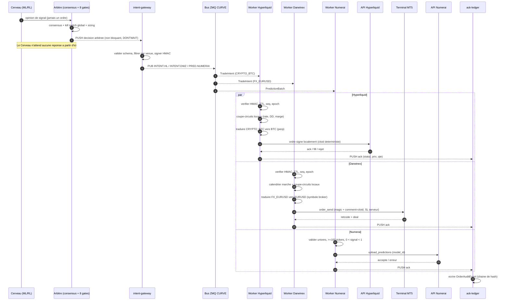
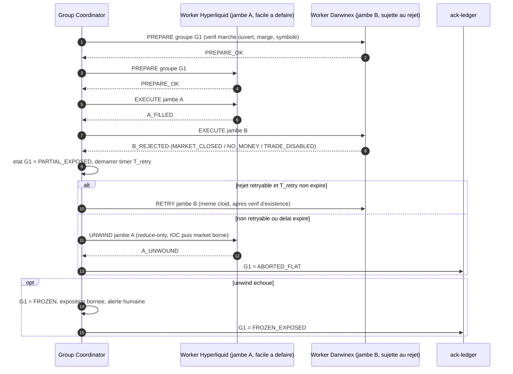

# Architecture Hub-and-Spoke : Cerveau Alpha vers 6 plateformes de capital externe, en 3 pôles

Statut : le **contrat** (`contracts/platform_signal.py`), le **transport signé** (`contracts/secure_signal_bus.py`) et trois workers (`workers/numerai`, `workers/hyperliquid`, `workers/bybit`, qui partagent le socle `workers/common`) sont implémentés et testés, mais **jamais exécutés contre les vraies plateformes**. Les 3 autres plateformes ont leur nom réservé dans le contrat et **aucun worker**. Les faits sur les plateformes viennent de recherches web et sont marqués **[à vérifier]** quand les sources divergent ou manquent. Les éléments du repo cités existent réellement (chemins indiqués).

Périmètre : exactement 6 plateformes, celles du tableau ci-dessous.

| Pôle | Plateformes | Exécution | Worker |
|---|---|---|---|
| Crypto | `HYPERLIQUID`, `BINANCE`, `BYBIT`, `ENZYME` | temps réel | Hyperliquid et Bybit écrits (dry-run) ; les 2 autres non écrits |
| Actions | `NUMERAI_SIGNALS` | batch quotidien | écrit (dry-run) |
| Forex / CFD | `DARWINEX_ZERO` | pont MT5 | non écrit |

---

## 0. Trois corrections de prémisses avant de construire

Le brief pose "zéro capital propre, zéro frais, zéro fuite d'IP". Les trois contraintes ne tiennent pas telles quelles. Mieux vaut le savoir avant de dessiner.

### 0.1 "Zéro capital, zéro frais" : tenable pour une seule plateforme sur six

| Plateforme | Coût réel d'entrée | Source |
|---|---|---|
| Numerai Signals | 0. Le staking de NMR est optionnel. Sans stake, tu reçois une performance mais, par inférence de la doc, pas de gain : le gain passe par le stake, donc par du capital **[inférence]**. | [docs.numer.ai](https://docs.numer.ai/numerai-signals/submissions) |
| Hyperliquid Vault | 100 USDC de dépôt minimum + 100 USDC de frais de création (doc courante ; une page "legacy" cite 10 000 USDC) + le leader garde au moins 5 % du vault en permanence. Nom et description du vault sont définitifs. **[confirmer le montant dans l'app]** | [HL docs](https://hyperliquid.gitbook.io/hyperliquid-docs/hypercore/vaults/for-vault-leaders), [Hummingbot](https://hummingbot.org/blog/funding-rate-arbitrage-and-creating-vaults-on-hyperliquid/) |
| Darwinex Zero | Abonnement mensuel payant. Pas de "challenge fee" au sens prop-firm, mais ce n'est pas gratuit. Prix divergents selon les sources (95 EUR d'inscription + 38 EUR/mois cité à l'époque du lancement) **[à vérifier sur darwinex.com]**. Le leader touche 15 % du profit sur capital alloué. | [Darwinex blog](https://blog.darwinex.com/darwinex-zero-new-subscription-service-what-is-it-and-how-it-works), [MQL5](https://www.mql5.com/en/blogs/post/773634) |
| Binance (lead trading) | Copy trading spot : portefeuille de lead entre 500 et 250 000 USDT (annonce de 2024) donc **capital propre requis** ; partage de profit de 10 % au lancement du spot. Critères actuels d'éligibilité pour le futures et disponibilité régionale **non trouvés** **[à vérifier]**. | [The Block](https://www.theblock.co/news/markets/2024-04-23-binance-spot-copy-trading-290345), [Binance dev docs](https://developers.binance.com/docs/copy_trading/future-copy-trading/Get-Futures-Lead-Trader-Status) |
| Bybit (master trader) | Critères officiels actuels **introuvables**. Une revue de 2024 décrit des niveaux (Cadet à Gold) avec des minimums d'actifs, de profits des followers sur 7 jours et de drawdown ; partage de profit de 10 à 15 %. **[à vérifier sur la page de candidature]** | [Coin Bureau (mars 2024)](https://coinbureau.com/review/bybit-copy-trading-review), [Bybit V5](https://bybit-exchange.github.io/docs/v5/copytrade) |
| Enzyme (vault EVM) | Création d'un vault via l'app (Ethereum ou Polygon). Aucun frais de création trouvé ; le coût documenté est le **gas** (créer et reconfigurer). Une modification des réglages d'un vault ne s'applique qu'après **7 jours**. Capital propre : non requis par la doc consultée, mais des déposants sont nécessaires pour avoir des fonds à gérer. | [Enzyme FAQ](https://docs.enzyme.finance/what-is-enzyme/faq), [reconfigurer un vault](https://docs.enzyme.finance/getting-started/customise-your-settings/reconfigure-your-vault) |

Conséquence : un budget minimal incompressible existe : environ 200 USDC pour Hyperliquid, l'abonnement Darwinex Zero, du gas pour Enzyme, et du capital propre pour Binance (et probablement Bybit). Seul Numerai est à coût nul pour entrer. Le plan ci-dessous le suppose.

### 0.2 "Zéro fuite d'IP" : vrai pour le code et les poids, faux pour l'alpha observable

Ce que l'architecture protège réellement : code, poids du modèle, features, hyperparamètres (aucun ne quitte le serveur du Cerveau).

Ce qu'elle ne peut pas protéger : le **flux d'ordres lui-même**. Un vault Hyperliquid est public et on-chain : positions, fills et timing sont lisibles par tous, copiables, et permettent de reconstruire une partie de la logique. Darwinex voit tous les trades. Numerai reçoit tes prédictions par construction. Mitigations en §5.4, sans promettre l'impossible.

### 0.3 Le moteur n'a pas encore de track record

Ces plateformes évaluent la performance réelle. Le dernier run 24 h en shadow (2026-09-23) s'est conclu NO-GO : 6 618 signaux de consensus, 0 fill, système resté en PANIC 98 % du temps après une coupure de flux, et le run n'a donc rien mesuré de la stratégie. Avant tout branchement externe, il faut une période de paper trading continue qui produit des fills mesurables (réarmement automatique du kill switch après reprise du flux, voir §6.6).

### 0.4 Le délai "1 à 3 mois" n'est confirmé par aucune source

La stratégie suppose un financement en 1 à 3 mois. Les sources trouvées ne le garantissent pour aucune plateforme : Darwinex Zero impose un entraînement de **90 jours maximum** avant que le DARWIN existe (le financement vient après)  ; pour Binance, Bybit et Enzyme, aucun délai n'a été trouvé. Prendre ce chiffre comme un objectif, pas comme un fait.

---

## 1. Architecture globale

### 1.1 Principe

Le Cerveau ne connaît aucune plateforme. Il publie une **intention** (jamais un ordre venue-spécifique) vers un `intent-gateway`, qui la valide, la filtre par venue, la signe, la diffuse. Chaque worker est un process isolé, sans route réseau vers le Cerveau.

```
                       [ HÔTE SÉCURISÉ LOCAL ]
 ┌──────────────────────────────────────────────────────────────────┐
 │ net_brain (Docker internal:true, AUCUN egress internet)          │
 │   brain  ──(ZMQ PUSH, non bloquant, HWM+drop)──►  intent-gateway│
 │   (modèles, poids, features)                                     │
 └───────────────────────────────────────────────┬──────────────────┘
                                                 │ (le gateway est sur 2 réseaux)
 ┌───────────────────────────────────────────────▼──────────────────┐
 │ net_bus (internal:true) : ZMQ PUB/XPUB + CURVE                   │
 └───┬──────────────────────────┬───────────────────────┬───────────┘
     │ pôle CRYPTO (temps réel) │ pôle ACTIONS (batch)  │ pôle FOREX (pont MT5)    
 ┌───▼──────────────────────┐ ┌─▼────────────────┐ ┌────▼─────────────────────┐
 │ w-hyper  w-binance       │ │ w-numerai        │ │ w-darwin                 │
 │ w-bybit  w-enzyme        │ │ egress: numer.ai │ │ HÔTE WINDOWS (terminal   │
 │ (enzyme : on-chain)      │ │                  │ │ MT5 requis)              │
 │ egress : sa plateforme   │ │                  │ │ egress : son courtier    │
 └───┬──────────────────────┘ └─┬────────────────┘ └────┬─────────────────────┘
     │ PUSH acks                │ PUSH acks             │ PUSH acks
     └──────────────────────────┴──────────┬────────────┘
                                     ┌─────▼──────┐
                                     │ ack-ledger │  (écrit dans l'audit ledger existant)
                                     └────────────┘   Le Cerveau ne lit PAS les acks en ligne.
```

**État réel du bus** : l'implémentation actuelle utilise **un seul topic** (`EXECUTION.SIGNAL`) ; chaque worker filtre sur `signal.targets(venue)` (`open_envelope`). Conséquence : tous les workers *reçoivent* tous les signaux. Des topics par plateforme, au niveau du gateway, restent à faire pour qu'un worker compromis ne voie que son propre flux (§5.2).

### 1.2 Règles de topologie

1. **Cerveau sans egress.** Réseau Docker `internal: true`. Les données de marché arrivent par un conteneur `market-data` séparé qui, lui, a un egress.
2. **Sens unique.** Brain → gateway par PUSH/PULL. Les acks vont à `ack-ledger`, pas au Cerveau. Une plateforme compromise ne peut ni interroger ni atteindre le Cerveau.
3. **Jamais bloquant.** Envoi ZMQ avec `DONTWAIT` et HWM borné. Si le bus est saturé, les intentions sont **abandonnées** (le TTL les aurait périmées de toute façon), jamais mises en file illimitée. Le Cerveau n'attend aucune réponse.
4. **Chiffrement + authentification du bus : ZMQ CURVE** (libzmq natif, supporté par pyzmq), une paire de clés par worker. Un worker ne peut s'abonner qu'à son propre topic (ACL au gateway). Un worker compromis ne voit que son flux.
5. **Egress en liste blanche par worker** (règles de pare-feu par conteneur) : `w-hyper` uniquement vers les domaines Hyperliquid, `w-numerai` uniquement vers numer.ai, etc.
6. **Worker Darwinex hors Docker Linux** : le package `MetaTrader5` est Windows-only et pilote un terminal MT5 en cours d'exécution. Il tourne en service Windows (ou VM Windows dédiée) et se connecte au bus en CURVE sur l'adresse du gateway.
7. **Aucune bibliothèque partagée avec le Cerveau.** Les workers importent uniquement un paquet `contracts` minimal (schémas Pydantic), jamais `core.quant_math` ni rien d'autre. Le repo a déjà un dossier `contracts/` ; il devient la frontière d'IP.

### 1.3 Réutilisation du repo

| Besoin | Existant à réutiliser |
|---|---|
| Bus pub/sub | `core/zmq_bus.py`, `core/zmq_broker.py` (à renforcer avec CURVE) |
| Schémas stricts | `core/schemas.py` : `extra="forbid"`, `frozen=True` (même discipline pour les nouveaux) |
| Kill switch global signé | `core/security.py` (HMAC + epoch anti-rejeu) |
| Coupe-circuits | `core/circuit_breaker.py` |
| Abstraction courtier | `src/execution/broker_gateway.py` : `BaseBroker`, `IBKRBrokerAdapter`, `CcxtBrokerAdapter` |
| Idempotence / audit | `src/execution/audit_ledger.py` (`OrderAuditEvent`, chaîne de hash) |
| Arbitrage multi-gates | `src/agents/execution/agent.py` (consensus, 8 gates) : reste **en amont** du gateway |
| Coffre de secrets | `src/execution/security_vault.py` |

Point de design important : le `TradingSignal` actuel (`-1/0/1` + `confidence`, jamais un ordre, consommé par `ExecutionAgent`) reste tel quel. Le nouveau flux part **après** l'arbitrage consensus et le kill switch global : les workers ne voient jamais une opinion brute de modèle, seulement une décision déjà arbitrée.

### 1.4 Le pont Cerveau -> workers (`src/bridge/`)

*Implémenté et testé : `src/bridge/platform_bridge.py`, lancé par `scripts/run_platform_bridge.py`. Jamais exécuté avec le vrai moteur en marche : voir les limites.*

**Format réel de la sortie du moteur** (lu dans le code, pas supposé) :

| Étape | Objet | Contenu |
|---|---|---|
| Opinion de chaque agent | `core.schemas.TradingSignal` sur le topic `TRADING_SIGNALS` | `timestamp`, `agent_id` (`supervisor-agent` = XGBoost, `rl-signal-agent` = PPO), `instrument` (`BTC/USDT`...), `signal` ∈ {-1, 0, 1}, `confidence` ∈ [0, 1] |
| Arbitrage | `ExecutionAgent` : consensus des deux agents, puis 8 portes | sorties : événement d'audit `GATE8_SEALED` (`ORDER_AUDIT_EVENTS`) et état des positions |
| État tenu par l'`ExecutionAgent` (Redis) | `NOTHIERLY_ACTIVE_POSITIONS` : liste JSON des positions non `FLAT` | `instrument`, `status` (`LONG`/`SHORT`), `entry_price`, `current_price`, `units`, `pnl`, `opened_at` |
| | `NOTHIERLY_EQUITY_CURVE` : liste Redis, la plus récente en tête | `{"timestamp", "balance"}` |
| | `heartbeat:execution-agent` : clé à durée de vie courte | présence = moteur vivant |

**Ce que le pont fait.** Il ne lit pas les opinions brutes et ne refait aucun arbitrage : il lit l'état arbitré ci-dessus, toutes les 2 s, et publie un `PlatformSignal` par instrument suivi.

- Position `LONG`/`SHORT` -> direction ; aucune position -> `FLAT`.
- Taille : `|unités| x prix / equity du moteur`, en %. C'est le dimensionnement du moteur (risque, plafonds) réutilisé tel quel ; plafonné par `--max-position-pct` (20 % par défaut). Chaque worker applique ensuite ce % à **sa** equity.
- `confidence_score` **n'est pas transmis** (interdit par le contrat pour toute plateforme crypto).
- Republication seulement si la cible change (direction, ou 0,25 point de plus ou de moins) ou toutes les 10 s : un worker lancé en retard se cale, et republier un état identique est sans effet (exposition cible).
- Un état plutôt qu'un flux d'événements : une fermeture simulée en MOCK/SHADOW ne publie pas toujours `TRADE_EXECUTED`, un événement de sortie manqué laisserait une position externe ouverte.

**Repli (toujours dans le sens qui réduit l'exposition).** Kill switch global actif (`PANIC`, `LATCHED_DATA`, Redis injoignable, signature invalide) : `FLAT` immédiat. Moteur silencieux (heartbeat absent) ou état illisible plus de 30 s : `FLAT`. Dans le délai de grâce : on ne publie rien. Equity inconnue avec une position ouverte : rien n'est publié pour elle (on ne devine pas une taille).

**Ce que le pont ne peut pas faire, honnêtement :**

- **Pas d'actions.** Le moteur n'a aucun modèle d'actions : ses instruments sont `BTC/USDT`, `ETH/USDT`, `EUR_USD`, `XAU_USD`. Rien ne peut alimenter `NUMERAI_SIGNALS`, qui exige 100 scores d'actions par jour minimum. Il faudrait un modèle de classement de l'univers d'actions, ce qui est un projet à part.
- **Pas de forex.** `DARWINEX_ZERO` exige un `stop_loss_price` que le moteur ne fournit pas ; `EUR_USD` et `XAU_USD` sont ignorés (avec un avertissement).
- **Décisions simulées.** En `MOCK_MODE`/`SHADOW`, les positions du moteur sont simulées. Un worker en mode live tradera de l'argent réel d'après elles : garder les workers en dry-run, testnet ou démo. Le pont l'affiche au démarrage.
- **Comptes dédiés.** Un worker ramène le compte à la cible de chaque symbole suivi, y compris `FLAT` : une position ouverte à la main sur ce symbole serait fermée.
- **Si le pont ou le moteur meurt**, ce sont les workers qui protègent : leur homme mort ferme toutes leurs positions après N secondes sans signal valide, puis les verrouille (voir §6.7).

---

## 2. Contrats de messages

> **Le contrat réellement implémenté est `contracts/platform_signal.py` (`PlatformSignal`)**, avec le transport signé de `contracts/secure_signal_bus.py`. Les schémas `TradeIntent` et `PredictionBatch` ci-dessous sont la conception initiale, gardés pour référence ; en cas de différence, le code fait foi. Différences notables : `confidence_score` n'est transmis qu'à `NUMERAI_SIGNALS` (interdit partout ailleurs), `position_size_pct` est une exposition **cible**, et `target_venue=ALL` couvre toutes les plateformes de la classe d'actif du signal.

### 2.1 `TradeIntent` v1 (Hyperliquid, Darwinex Zero)

```json
{
  "schema": "trade_intent",
  "schema_version": 1,
  "msg_id": "0192f3c8-7a52-7c1e-9b0a-3f6d1c2e8a41",
  "stream_seq": 48213,
  "emitted_at_ns": 1760371200123456789,
  "ttl_ms": 1500,
  "kill_epoch": 159,
  "brain_ref": "b-01",
  "group_id": null,
  "instrument": "CRYPTO_BTC",
  "intent": "TARGET_EXPOSURE",
  "side": "LONG",
  "target_exposure_frac": 0.12,
  "order_style": "LIMIT_IOC",
  "limit_px_bps_from_ref": 4,
  "ref_px": 86512.5,
  "reduce_only": false,
  "urgency": "NORMAL",
  "sig": "base64(hmac_sha256(canonical_json_without_sig))"
}
```

Choix de conception :

- **`target_exposure_frac`** (fraction du capital du compte), jamais un montant absolu. Chaque worker le convertit avec **sa propre** equity lue sur la venue. Évite de fuiter la taille réelle du Cerveau et rend chaque compte autonome.
- **`intent`** ∈ `TARGET_EXPOSURE | FLATTEN | REDUCE | HALT`. Un état cible est idempotent par nature : rejouer le même message ne double pas la position (contrairement à "acheter 1 BTC").
- **`ttl_ms` + `emitted_at_ns`** : le worker rejette tout message périmé (latence, file, reconnexion). Contrôle d'horloge : dérive NTP surveillée, rejet si skew > seuil.
- **`stream_seq`** monotone par topic : un trou révèle un message perdu ; le worker se resynchronise sur l'état cible courant (pas de rattrapage des intentions manquées).
- **`kill_epoch`** : l'epoch du kill switch global signé. Le worker refuse un message dont l'epoch est inférieur à son plus haut epoch vu (même logique anti-rejeu que `core/security.py`).
- **`sig`** : HMAC (clé distincte par worker, rotation planifiée). CURVE authentifie le canal, le HMAC authentifie le message.
- **Pas de `confidence`, pas de features, pas de nom d'agent.** Seule une décision arbitrée sort. `brain_ref` est opaque.
- **`group_id`** : renseigné seulement pour les jambes d'un groupe couvert (voir §6.3), `null` par défaut.

L'identifiant d'ordre côté venue est dérivé de façon déterministe : `client_order_id = H(msg_id || venue || leg)`. Hyperliquid accepte un `cloid` de 128 bits hex ; pour MT5 on le met dans `comment` et on encode un `magic` par stratégie.

### 2.2 `PredictionBatch` v1 (Numerai Signals)

```json
{
  "schema": "prediction_batch",
  "schema_version": 1,
  "msg_id": "…",
  "as_of_date": "2026-10-13",
  "universe_ver": "numerai-signals-2026-10-13",
  "rows": [
    {"instrument": "EQUITY_US_AAPL", "score": 0.7312},
    {"instrument": "EQUITY_US_MSFT", "score": 0.4127}
  ],
  "sig": "…"
}
```

Contraintes Numerai (doc officielle) : colonne ticker valide (sedol, bloomberg_ticker, composite_figi ou numerai_ticker) + colonne `signal` strictement entre 0 et 1, **au moins 100 tickers valides** de l'univers du jour, pas de doublon. Le worker revalide avec `ticker_universe()` avant l'upload. Le Cerveau envoie des **scores**, jamais des probabilités brutes de modèle : un classement rang-normalisé suffit et fuite moins.

---

## 3. Diagrammes de séquence (Mermaid)

### 3.1 Flux nominal



### 3.2 Échec asymétrique d'un groupe couvert



---

## 4. Spécifications par worker

### 4.1 Langage : Python partout

Rust ou C++ n'apportent rien ici. La latence est dominée par l'API de la venue (centaines de ms pour Hyperliquid, IPC vers le terminal pour MT5, job quotidien pour Numerai), pas par le code du worker. Les SDK officiels sont en Python, et la fiabilité (reconnexion, idempotence, réconciliation) compte plus que la vitesse. Seule exception défendable : un EA MQL5 côté Darwinex si le package Python s'avère instable (§4.3).

### 4.2 Worker Hyperliquid

*Implémenté : `workers/hyperliquid/` (dry-run testnet par défaut, jamais exécuté contre le service).*

- **SDK** : `hyperliquid-python-sdk` (officiel). REST pour les ordres, WebSocket pour `userEvents`, `orderUpdates`, `l2Book`.
- **Auth** : ne jamais mettre la clé du wallet maître dans le worker. Créer une **API wallet** (agent) approuvée par le maître : elle peut trader mais **ne peut pas retirer**. Pour un vault, l'ordre est passé avec `vaultAddress` ; vérifier dans la doc courante que l'agent du leader est autorisé pour le vault **[à vérifier avant le dev]**.
- **Nonces** : Hyperliquid impose des nonces par signataire. Un API wallet **distinct par process** évite les collisions si tu scales plus tard.
- **Clé** : jamais en clair dans l'image. Docker secret ou `security_vault.py`, chargée en mémoire au démarrage.
- **Dead-man switch** : armer périodiquement `scheduleCancel` (annulation automatique des ordres si le worker meurt) **[vérifier l'action dans la doc courante]**.
- **WebSocket** : ping applicatif régulier (la doc indique une fermeture sur inactivité d'environ 60 s **[à vérifier]**), reconnexion avec backoff exponentiel + jitter, puis **resynchronisation par REST** (`clearinghouseState`, `openOrders`) avant de reprendre. Jamais de reprise sur la seule foi du flux WS.
- **Table de symboles** : `CRYPTO_BTC` → `BTC` (perp), `CRYPTO_ETH` → `ETH`, avec précision de prix/taille propre à chaque marché lue depuis `meta`.

### 4.3 Worker Darwinex Zero

*Non écrit.*

- **Pont** : package `MetaTrader5` (Windows uniquement, terminal MT5 requis et connecté). Alternative : EA MQL5 + liaison ZMQ (connecteur type "DWX ZeroMQ"), plus robuste si le package Python décroche, au prix d'un code MQL5 à maintenir.
- **Fait à vérifier** : plateforme exacte du compte Darwinex Zero (MT4/MT5) et symboles disponibles **[à vérifier avant le dev]**. Les trades du compte alimentent l'indice DARWIN après un entraînement de 90 jours maximum, donc le worker ne doit jamais envoyer d'ordres de test.
- **Auth** : identifiants du compte dans le coffre ; le terminal reste connecté sur l'hôte Windows. L'hôte n'expose aucun port entrant.
- **Sécurité des positions** : chaque ordre porte un **SL serveur** (stop-loss côté courtier). Si le pont ou le worker meurt, la position n'est pas nue.
- **Idempotence** : `magic` = identifiant de stratégie, `comment` = `cloid` tronqué. Avant tout retry après timeout, interroger positions et ordres par `comment` : un `order_send` sans réponse est **ambigu**, jamais rejouer à l'aveugle.
- **Table de symboles** : `FX_EURUSD` → symbole broker (suffixes possibles), arrondis de lot, `trade_stops_level`, `trade_mode`.
- **Calendrier** : le Forex est fermé le week-end, les indices ont leurs sessions. Une porte de calendrier évite des rejets "market closed" parfaitement prévisibles.

### 4.4 Worker Numerai Signals

*Implémenté : `workers/numerai/` (dry-run par défaut, jamais soumis).*

- **SDK** : `numerapi` (`SignalsAPI` : `upload_predictions`, `ticker_universe`). Clés `public_id` / `secret_key` à portée **limitée** (upload seulement).
- **Cadence** : une fois par période de soumission. Pas de temps réel, pas de risque d'exécution : le pire cas est un fichier invalide ou manqué.
- **Garde-fous** : ≥100 tickers de l'univers du jour, 0 < signal < 1, pas de doublon, dérive de distribution (corrélation avec la soumission précédente) pour détecter un modèle cassé avant l'envoi.
- **Sortie** : le seul worker dont la "fuite" (scores par ticker) est le produit lui-même.

### 4.5 Worker Binance (lead trading) : non écrit

- **API officielle documentée** : statut de lead trader futures (`isLeadTrader`) et liste blanche de symboles (`GET /sapi/v1/copyTrading/futures/leadSymbol`).
- **Non confirmé** : qu'un compte lead puisse **passer des ordres par API** pour son portefeuille de copy trading. Je n'ai trouvé que des endpoints de lecture. À clarifier auprès de Binance **avant** d'écrire quoi que ce soit.
- Éligibilité actuelle (futures) et disponibilité par région : non trouvées.
- Le repo a un `CcxtBrokerAdapter` (`src/execution/broker_gateway.py`) à évaluer, mais il ne couvre pas les endpoints spécifiques au copy trading.

### 4.6 Worker Bybit (master trader)

*Implémenté : `workers/bybit/` (dry-run testnet par défaut, jamais exécuté contre le service, aucune clé utilisée).*

Ce qui vient de la doc V5 officielle et est appliqué dans le code :

- **Ordre** : `POST /v5/order/create` (`category=linear`), quantité et prix en chaînes, `orderLinkId` unique de 36 caractères maximum, `reduceOnly`, `positionIdx`. **Perpétuels USDT uniquement** pour le copy trading ; le champ `copyTrading` d'`instruments-info` dit si un symbole est éligible (le worker refuse `none`).
- **Signature** : `HMAC_SHA256(secret, timestamp + clé API + recv_window + (query | corps JSON))`, en hexadécimal ; le corps est signé tel qu'envoyé. Testée contre la formule recalculée indépendamment.
- **Réponse asynchrone** : Bybit n'accuse que la réception (« please use the websocket to confirm the order status »). Le statut journalisé est `accepted`, jamais `filled` : le remplissage réel se lit dans la position au signal suivant, qui est la source de vérité de la logique d'exposition.
- **Garde-fou de clé** : `GET /v5/user/query-api` expose les permissions. La CLI **refuse toute clé avec `Wallet: Withdraw`** (même en dry-run), et en mode live toute clé en lecture seule ou sans « Contract - Orders & Positions ».
- Les ordres `MARKET` du signal sont envoyés en **limite IOC** bornée par `max_slippage_bps` autour du mid (le plafond de glissement est le nôtre) ; achat arrondi au tick supérieur, vente au tick inférieur.

**Inconnues non tranchées par la doc, traitées en échec sûr** (à vérifier sur testnet avec une vraie clé) :

- **Où sont les fonds d'un master trader ?** Seul `accountType=UNIFIED` est documenté pour `wallet-balance`. Une equity lue sur le mauvais compte fausserait la taille des ordres. Parade : `--max-equity-usd` plafonne l'equity utilisée pour dimensionner.
- **Mode de position.** Le worker ne gère que le mode one-way (`positionIdx` 0) ; une position hedge arrête l'ordre (`hedge_mode_unsupported`). L'exemple copy trading de la doc utilise `positionIdx: 1` : si les comptes de copy trading sont en hedge, le worker devra être étendu.
- **Dry-run avec clé.** Solde et positions sont des données privées : même le dry-run exige une clé API (en lecture seule de préférence).
- Critères pour devenir master : introuvables officiellement (voir §0.1) ; passer par la page de candidature de Bybit.

### 4.7 Worker Enzyme (vault EVM) : non écrit

- **Nature différente des autres** : transactions on-chain (gas, confirmation en blocs, slippage, exposition au MEV). Pas de temps réel type Hyperliquid. Le repo a déjà un relais protégé contre le MEV (commit `c0d6026`) à évaluer.
- **Intégrations** : le trading passe par des adaptateurs DeFi (Uniswap, Aave, Compound, GMX, Balancer, Curve...). Un manager peut restreindre les adaptateurs autorisés. La doc décrit aussi un mode de **trading délégué** (équivalent d'un wallet agent) **[à lire avant de concevoir l'authentification]**.
- **Vault spot** : un `SHORT` n'est pas exécutable sur du spot. Le worker devra traiter `SHORT` comme `FLAT` (ne pas shorter), sauf intégration de perpétuels (GMX) confirmée.
- **Réglages** : toute modification du vault est soumise à un délai de 7 jours, donc les paramètres de risque se fixent à la création, pas au fil de l'eau.

### 4.8 Gestion des secrets (commun)

1. Aucun secret dans l'image ni dans git (`real_keys.env` à la racine du repo est à sortir du dossier de travail et à auditer).
2. Docker secrets (fichiers montés en tmpfs) ou `security_vault.py`.
3. Clés à privilège minimal : API wallet sans retrait (HL), upload seul (Numerai), clé API sans droit de retrait (Binance, Bybit : ordres seulement), wallet délégué sans retrait (Enzyme).
4. Rotation planifiée des clés HMAC du bus et des clés CURVE.
5. Les logs des workers ne contiennent jamais de clé, de signature complète ni de champ du Cerveau.

---

## 5. Protection de l'IP

### 5.1 Ce qui sort, par plateforme

| Plateforme | Ce qui sort | Réversibilité |
|---|---|---|
| Numerai | scores par ticker | volontaire, c'est le produit |
| Hyperliquid | ordres + positions publiques on-chain | **élevée** : copiable, partiellement déductible |
| Darwinex Zero | trades du compte, copiés aux investisseurs | moyenne |
| Binance, Bybit | trades du compte lead, **visibles et copiés par les followers** | élevée : le copy trading est de la copie par construction |
| Enzyme | transactions et positions **publiques on-chain** | élevée |

### 5.2 Règles

1. Le gateway **filtre** : chaque topic ne contient que le strict nécessaire pour sa venue. *(À faire : aujourd'hui un seul topic, voir §1.1.)*
2. Tailles relatives (fractions), jamais d'absolu.
3. Pas de features ni de nom d'agent dans les messages ; `confidence_score` **uniquement** pour `NUMERAI_SIGNALS` (le contrat refuse tout signal qui l'envoie ailleurs).
4. Workers sans accès au Cerveau (réseaux séparés, sens unique).
5. Poids et code du modèle chiffrés au repos sur l'hôte du Cerveau, aucun volume partagé avec les workers.

### 5.3 Mitigations de l'alpha observable (Hyperliquid surtout)

Aucune ne rend la stratégie indéductible ; elles augmentent le coût de copie :
- Bruit de timing borné (jitter de quelques centaines de ms) et fractionnement des ordres.
- Prix limites légèrement variés.
- Éviter les signatures évidentes (même taille, même heure).
- Choisir le **vault dans un horizon où la copie fait peu de dégât** (stratégie moins sensible au front-running).

### 5.4 Limite honnête

Si ton edge repose sur la rareté d'un signal facile à déduire du flux d'ordres, un vault public le diffusera. Dans ce cas, Numerai (scores seuls) et Darwinex Zero (flux vu par Darwinex et ses investisseurs, pas public on-chain) sont les chemins les plus protecteurs.

---

## 6. Kill-switches et gestion des pannes

### 6.1 Quatre niveaux

| Niveau | Où | Rôle |
|---|---|---|
| L0 | `core/security.py` global signé | arrêt systémique (flux perdu, flash crash). Réutilisé tel quel. |
| L1 | Arbitre du Cerveau (consensus + gates) | filtre les décisions avant publication |
| L2 | **Chaque worker, local** | rejette les intentions si la venue ou le compte l'exige |
| L3 | Venue (SL serveur MT5, reduce-only HL, `scheduleCancel`) | protège même si le worker est mort |

Le L2 est autonome : il juge sur **l'état réel de la venue** (equity et marge lues chez elle), jamais sur ce que dit le Cerveau.

### 6.2 Coupe-circuits locaux d'un worker

- Budget d'API (token bucket) par venue, rejet quand épuisé.
- Max drawdown du compte (calculé depuis l'equity venue) → mode `REDUCE_ONLY` puis `FLATTEN`.
- Exposition brute et marge utilisée > seuil → refus des intentions augmentant le risque.
- TTL expiré, trou de `stream_seq`, `kill_epoch` en recul, signature invalide, skew d'horloge → rejet silencieux et compté.
- N rejets consécutifs venue → circuit ouvert (réutiliser `core/circuit_breaker.py`), réarmement par demi-ouverture.
- Réconciliation : écart entre la position attendue et la position venue → gel du worker + alerte.

### 6.3 Kill-switch asymétrique : l'ordre passe en crypto, le Forex refuse

D'abord une question de fond : une jambe crypto (Hyperliquid) et une jambe Forex (Darwinex) sont sur des **comptes indépendants**, sans atomicité entre eux. Et couvrir du crypto avec du Forex n'a pas de sens économique. **Défaut recommandé : chaque venue est un livre indépendant** (`group_id = null`) ; un rejet sur une venue ne touche pas les autres.

Si un vrai groupe couvert existe (`group_id` renseigné), pattern **saga avec compensation**, porté par un `Group Coordinator` hors du Cerveau :

1. **PREPARE** sur toutes les jambes : marché ouvert, marge suffisante, symbole négociable. Élimine les rejets prévisibles.
2. **Ordre d'exécution** : d'abord la jambe **la plus facile à défaire** (liquide, ex. BTC perp), ensuite la plus sujette au rejet (Darwinex). Si la 2e échoue, on défait la 1re à moindre coût.
3. États : `PREPARED → LEG_A_FILLED → PARTIAL_EXPOSED → COMPLETE | ABORTED_FLAT | FROZEN_EXPOSED`.
4. Rejet de B : classer **retryable** (requote, timeout après vérification d'existence) ou **non retryable** (`MARKET_CLOSED`, `NO_MONEY`, `TRADE_DISABLED`). Retry borné par `T_retry`.
5. Sinon **UNWIND** de A : `reduce_only`, IOC puis ordre marché borné (slippage max).
6. Si l'unwind échoue : `FROZEN_EXPOSED`, exposition plafonnée, plus aucune nouvelle intention pour ce groupe, alerte humaine.
7. Chaque transition est écrite dans le ledger (reprise après crash du coordinateur).

### 6.4 Déconnexion WebSocket Hyperliquid

Le worker tombe seul, le Cerveau n'en sait rien.
1. Détection : pas de message / pong dans la fenêtre → état `DEGRADED`, **plus de nouvelles intentions** acceptées.
2. Reconnexion avec backoff + jitter.
3. Resync REST (positions, ordres ouverts, fills manqués) avant de repasser `HEALTHY`.
4. Les intentions reçues pendant la panne sont **périmées** (TTL) : on ne rejoue rien ; la prochaine `TARGET_EXPOSURE` redresse l'état.
5. Si la panne dépasse un seuil : `FLATTEN` conditionnel ou garde des ordres de protection (`scheduleCancel` pour nettoyer).

### 6.5 Rejets et pannes MT5 (Darwinex)

- Table de `retcode` → {retryable, non retryable, à escalader}. Exemples : requote/prix changé (retry borné), marché fermé / trading désactivé (non retryable, attendre la session), fonds insuffisants (non retryable, alerte).
- Terminal déconnecté ou `initialize()` en échec : superviseur Windows qui relance le terminal ; pendant ce temps le worker reste `DEGRADED` et les SL serveur protègent les positions ouvertes.
- Timeout sans réponse : **ne jamais renvoyer l'ordre** avant d'avoir interrogé positions/ordres par `comment`.

### 6.6 Isolation du Cerveau

- ZMQ avec HWM + `DONTWAIT` : un worker lent ou mort ne ralentit jamais le Cerveau, il fait seulement perdre des messages.
- Aucun appel synchrone vers un worker. Les acks vont au ledger, lus par l'opérateur et le tableau de bord.
- Réarmement automatique du kill switch global après reprise du flux de marché stable (conditions explicites, ex. N minutes de flux sain). C'est le correctif à apporter avant le paper trading (voir §0.3 : le run 24 h est resté en PANIC faute de réarmement).

### 6.7 Homme mort (Dead Man's Switch) des workers temps réel

*Implémenté dans `workers/common/base.py`, donc pour Hyperliquid et Bybit (et tout futur worker temps réel). Testé, y compris par un scénario à trois processus où le pont est tué. Jamais exécuté contre une vraie plateforme.*

**Pourquoi.** Si le moteur plante, si Windows redémarre ou si le réseau lâche, un worker qui garde sa dernière position sans plus rien entendre reste exposé à l'aveugle. Le coupe-circuit de drawdown ne couvre pas ce cas : il se déclenche sur une perte, pas sur un silence.

**Comportement.**

| Élément | Règle |
|---|---|
| Horloge | `last_signal` de chaque actif est écrit dans SQLite à chaque signal **valide** (un `FLAT` compte : c'est la preuve que le moteur est vivant). Il survit à un redémarrage du worker. |
| Délai | `--dead-man-timeout N` (secondes, **300 par défaut**, `0` = désactivé). Dépassement **strict** : à exactement N secondes, rien ne se passe. |
| Déclenchement | Délai dépassé **et** position ouverte (lue sur le compte). Actif déjà à plat : rien à faire, et il n'est pas relu avant `max(N, 60)` s. |
| Fermeture | Tous les actifs suivis par le worker sont fermés, pas seulement le silencieux : une fois verrouillé, plus aucun signal n'est traité, une position laissée serait aveugle. Ordre `reduce_only` IOC à `mid ± 3 %`. |
| Répétition | L'IOC peut ne pas se remplir. À chaque intervalle le worker relit la position et **réessaie tant qu'elle n'est pas nulle**, avec un écart doublé à chaque tentative (3 %, 6 %, 12 %, puis plafond 20 %). |
| `HALTED` | Persistant. Tout signal reçu ensuite est refusé sans traitement (`dead_man_halted`, niveau debug). Les signaux en attente sont jetés. |
| Réarmement | `--clear-halt`, lancé depuis un autre processus : le worker en marche le voit sans redémarrer, et les horloges repartent de maintenant. Si le moteur est toujours muet, il redéclenche après N secondes. |
| Redémarrage | Délai de grâce de 30 s au démarrage (`dead_man_startup_grace_s`) : un worker relancé ne se déclenche pas avant que le moteur ait pu lui parler, même si son dernier signal persisté est très ancien. Au-delà, le silence compte depuis le vrai dernier signal. |
| Capacité | `supports_dead_man` par classe de worker : une plateforme sans sortie d'urgence refuse l'option (erreur explicite, jamais ignorée). Le worker Numerai n'hérite pas de ce socle (asynchrone, aucune position). |
| Mainnet | `--live --network mainnet` avec `--dead-man-timeout 0` est refusé. |

**Limites à connaître.**

- **Le worker doit être vivant pour agir.** S'il est lui-même arrêté (Windows, crash) pendant la panne, il ne peut rien fermer ; il le fera à son retour, après le délai de grâce. Aucune protection côté plateforme n'est ajoutée ici (ordres de stop déposés chez le courtier, `scheduleCancel` sur Hyperliquid).
- **Horloges murales.** Un saut d'horloge vers l'avant supérieur à N déclenche (sens sûr : on réduit).
- **Mode hedge Bybit.** Une position hedge ne se ferme pas avec un ordre one-way : le worker le signale en `CRITICAL`, n'envoie rien et réessaie. Elle doit alors être fermée à la main.
- **Dry-run.** La sortie est simulée (journalisée, jamais envoyée) mais le worker se verrouille quand même, pour que le comportement soit observable.
- **Comptes dédiés.** Les actifs suivis sont ceux pour lesquels le worker a reçu un signal ; une position ouverte à la main sur un autre symbole n'est pas touchée.

---

## 7. Plan de mise en œuvre (ordre recommandé)

| Phase | Contenu | État / coût |
|---|---|---|
| 0 | Paper trading continu avec réarmement auto du kill switch, produire des fills mesurables et un track record interne | à faire, 0 |
| 1 | Contrat `PlatformSignal` + transport signé | **fait** ; restent : `intent-gateway`, topics par plateforme, CURVE, ack-ledger |
| 2 | **Numerai Signals** : worker + validations (aucune exécution) | **fait** (dry-run) ; soumission réelle non testée ; 0 |
| 3 | **Hyperliquid** : worker temps réel, clé agent sans retrait | **fait** (dry-run) ; testnet à faire ; ≈200 USDC + stake pour un vault |
| 4 | **Bybit** : API V5, perp USDT, clé sans retrait | **fait** (dry-run) ; testnet à faire ; compte des fonds et mode de position à confirmer ; critères master à confirmer |
| 5 | **Darwinex Zero** : pont MT5 Windows, SL serveur, calendrier, idempotence | à écrire ; abonnement |
| 6 | **Enzyme** : vault EVM, relais anti-MEV | à écrire ; gas |
| 7 | **Binance** : seulement après confirmation écrite des conditions et de l'API d'ordres | bloqué par des inconnues |

Ordre = choix de risque et d'information disponible (API documentée d'abord, inconnues en dernier), pas une promesse de délai (§0.4).

Chaque phase se termine par un test de chaos (kill du worker, coupure WS, rejet MT5 simulé) avant la suivante, avec l'harnais `scripts/run_chaos_shadow_run.py`.

---

## Sources

- [Numerai Signals, soumissions](https://docs.numer.ai/numerai-signals/submissions) · [numerapi](https://numerapi.readthedocs.io/en/latest/api/numerapi.html)
- [Hyperliquid, vault leaders](https://hyperliquid.gitbook.io/hyperliquid-docs/hypercore/vaults/for-vault-leaders) · [Hummingbot, création de vault](https://hummingbot.org/blog/funding-rate-arbitrage-and-creating-vaults-on-hyperliquid/)
- [Darwinex Zero, fonctionnement](https://blog.darwinex.com/darwinex-zero-new-subscription-service-what-is-it-and-how-it-works) · [MQL5, retour d'expérience](https://www.mql5.com/en/blogs/post/773634)
- [Binance, statut lead trader futures](https://developers.binance.com/docs/copy_trading/future-copy-trading/Get-Futures-Lead-Trader-Status) · [The Block, spot copy trading](https://www.theblock.co/news/markets/2024-04-23-binance-spot-copy-trading-290345)
- [Bybit V5, copy trading](https://bybit-exchange.github.io/docs/v5/copytrade) · [Coin Bureau, revue (2024)](https://coinbureau.com/review/bybit-copy-trading-review)
- [Enzyme, FAQ](https://docs.enzyme.finance/what-is-enzyme/faq) · [reconfigurer un vault](https://docs.enzyme.finance/getting-started/customise-your-settings/reconfigure-your-vault) · [trading délégué](https://docs.enzyme.finance/getting-started/customise-your-settings/delegate-trading)
